# Running Docker Swarm Across Friends' PCs with Tailscale

> **Draft v2.** Same story and order as the original, rebuilt around the diagrams in [`../diagrams/`](../diagrams), with the corrections from the technical review applied. New or changed material is marked in the [change notes](#change-notes) at the end.
>
> **How this series is organised.** This article tells the story and ends with a hands-on setup. The companion, [NAT and Tailscale from First Principles](tailscale-nat-deep-dive.md), is the reference for how NAT and Tailscale work. You can read this article first and jump across when it says so.
>
> **How claims are labelled.** *Documented* means a vendor's documentation says it. *Observed* means I ran it (Docker 29.9.2, Linux 6.18, a single-node swarm). *Inferred* means it follows from the documented behaviour but I have not tested it. Docker Desktop on Windows could not be tested; everything about its internals is therefore documented or marked inferred.

I've always wanted a personal cloud. Not rented VMs from AWS or GCP, but something built from machines I actually own. My friends and I all have powerful PCs sitting around, and the idea clicked: why not pool them?

My first thought was **Docker Desktop's Swarm mode**. My friends have Docker Desktop installed, and Swarm is built in. As soon as I tried it, I hit a wall. Firewalls, NAT, public IPs and the plumbing of Docker Desktop all work against you. In this post we take those walls apart, understand *why* they exist, and build an encrypted multi-node cluster using **Tailscale** and **WSL2** (a way to run Linux inside Windows, explained when we need it).

**What you will be able to do at the end**

- Explain why two PCs in different homes cannot just connect.
- Explain what Docker Swarm needs from the network, and why.
- Explain how containers on different machines talk to each other (overlay networks, VXLAN).
- Explain what we do and do not know about Docker Desktop as a Swarm node.
- Build and test a three-node Swarm over Tailscale.

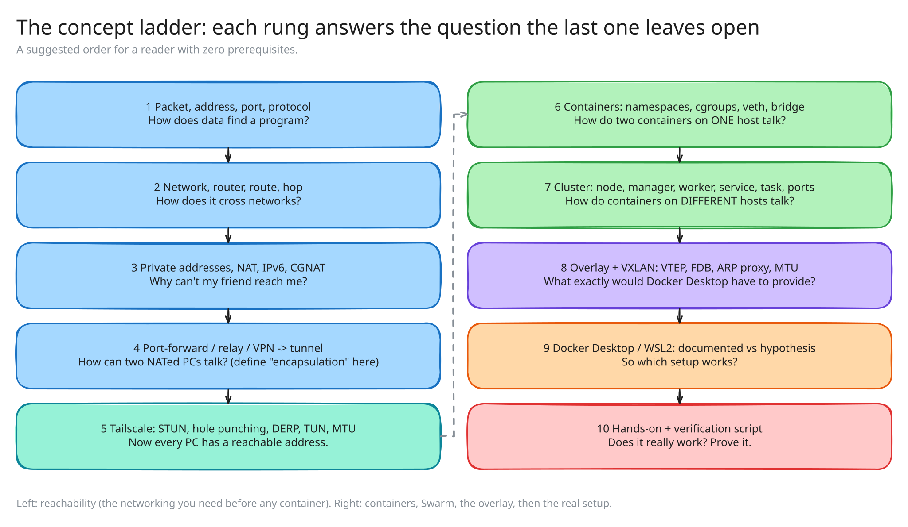

**How to use the map.** The ladder is the order of this series. Each rung exists because the rung below leaves one question open: reaching a program (ports) leads to crossing networks (routers), which leads to the NAT problem, to the ways out (relays, VPNs), to Tailscale, to containers and clusters, to overlays, to the Docker Desktop question, and finally to the hands-on setup. If a section feels like a detour, find its rung and read the question it answers.

---

## 1. Why I thought Docker Swarm would work

I knew Kubernetes existed, but a Kubernetes cluster comes with a lot of extra work: control planes, worker nodes, networking plugins, configuration. For a casual project with friends that felt like overkill. Kubernetes was my last resort.

Docker Swarm is built into Docker. No separate installation, no extra components. Swarm mode should be one `docker swarm init` away. Or is it?

---

## 2. The first problem: connectivity

Before thinking about Swarm there is a more basic question: how do I even reach my friend's PC? The machines are in different houses, on different networks.

The options I could think of were SSH, RDP, port forwarding and Ngrok. Port forwarding could work, but not everyone controls their router, and some ISPs block it anyway. The others need the target machine to be directly reachable, which is the same problem again.

That left two approaches:

1. **Rent a VM with a public IP**: a relay point everyone connects to.
2. **Use a VPN**: make our devices appear to be on one network.

I did not know yet which suited Swarm, but connectivity had to be solved first.

---

## 3. Before trying anything: does this even work?

Before asking friends to install VPNs or renting a relay, I wanted to know whether anyone had done this: can Docker Desktop instances on different machines form a Swarm?

Docker Desktop is a local development tool. It runs Docker inside a virtual machine and handles networking behind the scenes. That is great on a laptop and awkward for a cluster, because the VM is not directly reachable from other machines.

That raised two questions, which structure the rest of the article:

1. What does Swarm need to work across multiple machines?
2. What exactly gets in the way when the machine runs Docker Desktop?

---

## 4A. What is Docker Swarm, in 90 seconds?

The rest of the article uses six words that are never defined in the Docker marketing material, so let's define them once.

- A **node** is one machine (physical or virtual) running Docker and joined to the cluster.
- A **manager** node keeps the cluster's records and decides what runs where. A **worker** node just runs what it is told. A manager can also run workloads.
- A **service** is what you *ask for*: "run three copies of nginx".
- A **task** (or **replica**) is *one running copy* of a service, one container, placed on a specific node.
- **Desired state** is the contract: you declare "3 copies"; Swarm keeps making it true. If a node dies, the manager notices and starts the missing copies elsewhere.
- A **cluster** or **swarm** is all of these nodes managed as one.

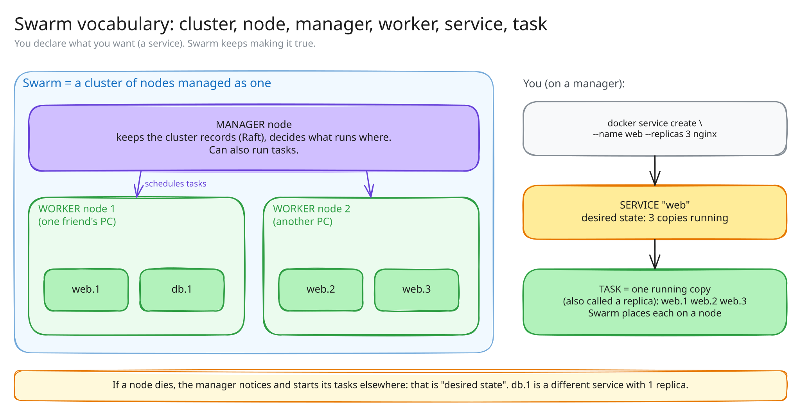

**How to read the diagram.** You type `docker service create --name web --replicas 3 nginx` on a manager. That creates *one* service with desired state "3 copies". The manager schedules three tasks, `web.1`, `web.2`, `web.3`, onto nodes of its choice. A second service, `db`, has one replica. If a worker's PC is switched off, its tasks disappear and the manager starts replacements elsewhere.

Everything that follows is about one question: *what must the network provide so that these nodes can form one cluster?*

---

## 4B. What does Swarm actually need?

After reading Docker's documentation, Swarm has a specific list of network requirements. All of them must hold for a multi-node cluster to work.

### The topology: a mesh

Swarm needs a **mesh**: every node can reach every other node directly. A client-server design has clients that only talk to a server. Hub-and-spoke has spokes that only reach each other through the hub. A mesh needs every participant to be a peer.

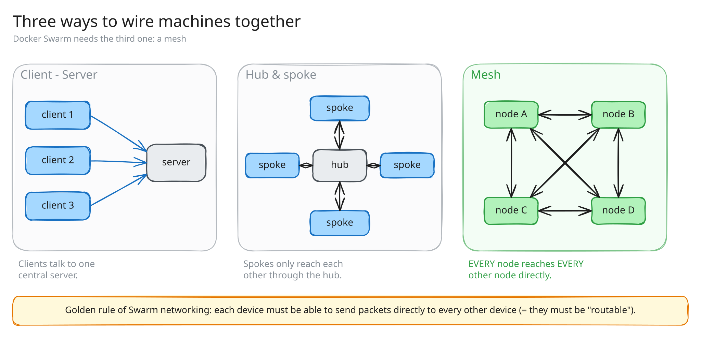

**The golden rule of Swarm networking:** each device must be able to send packets directly to every other device in the cluster.

### Defining "routable"

To be part of a mesh, devices must be **routable**.

> **Routable**: a packet addressed to the device's IP address can be delivered to it from where the sender sits, along a valid path.

Whether that holds depends on where the devices are:

1. **Same LAN or Wi-Fi.** All devices share one router, have private addresses such as `192.168.1.5`, and the router delivers between them.
2. **Public IP addresses.** Each device has its own public address, so any device can reach any other.
3. **Private addresses behind NAT.** The device's address is private and one or two layers of **NAT** (explained in the companion article, section 1) sit between it and the Internet. These can be your home router, your ISP's carrier-grade NAT (CGNAT), or both.

Friends' PCs are almost always case 3. To see why that is a problem, we need to follow a packet.

### How packets travel: hops

Data crossing the Internet does not go in one jump. It is handed from router to router. Each handover is a **hop**.

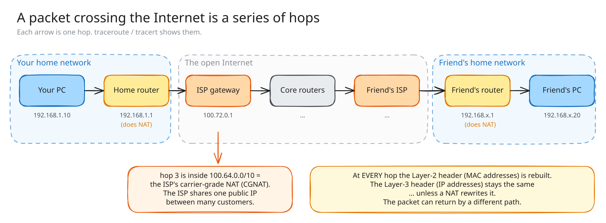

**How to read the diagram.** Left to right: your PC, your home router (which does NAT), your ISP's gateway, a chain of core routers, your friend's ISP, your friend's router (also NAT), your friend's PC. Each arrow is one hop. The note below the diagram marks the thing to remember: at every hop the Layer-2 header is rebuilt, and the Layer-3 header stays the same *unless a NAT rewrites it*. The callout on hop 3 is explained right after the next exercise.

### See it yourself: `traceroute`

1. Open a terminal on your PC.
2. Run `tracert 8.8.8.8` (Windows) or `traceroute 8.8.8.8` (macOS or Linux).

This prints each router your packets pass on the way to Google's DNS server, with response times. An example run:

```text
Tracing route to dns.google [8.8.8.8]
over a maximum of 30 hops:

  1     2 ms    <1 ms    <1 ms  192.168.0.1
  2    12 ms     3 ms     7 ms  192.168.1.1
  3     *       88 ms    51 ms  100.72.0.1
  4    28 ms    55 ms    58 ms  172.253.66.125
  5     9 ms     9 ms     9 ms  108.170.248.161
  6     8 ms     7 ms     6 ms  142.251.232.115
  7    32 ms    22 ms    10 ms  dns.google [8.8.8.8]
```

**Look closely at hops 1 to 3.** Hop 1 and 2 are both private addresses (`192.168.x.x`): two routers in this home, so two NATs. Hop 3, `100.72.0.1`, is **not** a normal public or home address. It lies inside `100.64.0.0/10`, a range reserved for ISPs' **carrier-grade NAT (CGNAT)**. This traveller's ISP is sharing one public IP among many customers. Keep this in mind: it is why "just open a port on the router" will fail for some of your friends, and the companion article, section 1, explains exactly why.

---

## 4C. The packet, layer by layer

To see why a hop sometimes rewrites an address and sometimes not, we need a vocabulary for what is *inside* a packet. Networks are described in **layers**, each wrapping the one above in its own header, like envelopes inside envelopes. The classic description is the 7-layer **OSI model**.

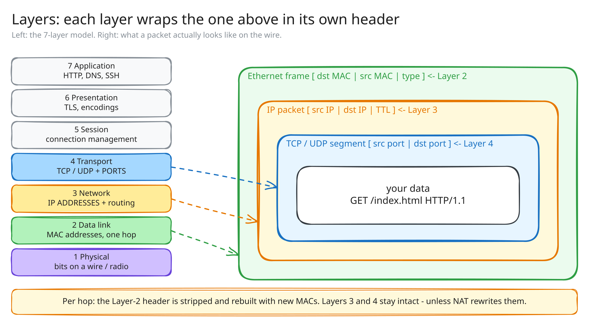

**How to read the diagram.** Left: the seven layers. Right: what a packet actually looks like. Your data (`GET /index.html`) is wrapped first in a **TCP or UDP header** (Layer 4: ports), then an **IP header** (Layer 3: source and destination IP address), then an **Ethernet header** (Layer 2: MAC addresses for one hop). The bottom note is the rule we will use all article: *per hop, the Layer-2 header is stripped and rebuilt; Layers 3 and 4 stay intact unless NAT rewrites them.*

Layers 5 to 7 matter less here, so briefly:

- **Layer 7, Application:** the protocols you use: HTTP, DNS, SSH, email.
- **Layer 6, Presentation:** encodings and encryption (TLS).
- **Layer 5, Session:** setting up and tearing down conversations.

The four lower layers are the ones that decide whether a packet arrives.

### Layer 4, Transport: protocol and port

- **TCP** is reliable and connection-oriented: it guarantees delivery and order.
- **UDP** is connectionless and fast: it sends and does not check.
- A **port** is a number that identifies a program on a device (80 is HTTP, 443 is HTTPS, 22 is SSH). The IP address gets a packet to the machine; the port gets it to the program.
- A **socket** (or endpoint) is an IP address plus a port: `192.168.1.10:443`.

```text
TRANSPORT HEADER (Layer 4)
  Source port 54321 | Destination port 443 | Sequence # | Checksum
  Application data (your payload)
Example: browser (port 54321) -> web server (port 443), TCP
```

### Layer 3, Network: IP addresses and routing

Layer 3 is **logical**: the destination IP says *where you want to go*, not every physical step to get there. Routers read the destination IP, consult a **routing table** (below) and pick the next hop.

```text
NETWORK HEADER (Layer 3)
  Version IPv4 | Source IP 192.168.1.10 | Destination IP 8.8.8.8 | TTL 64
  Layer 4 data (TCP/UDP header + payload)
TTL falls by one at every router; at zero the packet is discarded.
```

### Layer 2, Data link: MAC addresses, one hop at a time

Layer 2 delivers between two devices that are **directly connected**: your PC and your router, or your router and the ISP's gateway. It uses **MAC addresses**, hardware identifiers burned into network cards.

```text
DATA LINK HEADER (Layer 2)
  Destination MAC AA:BB:CC:DD:EE:FF (router) | Source MAC 11:22:33:44:55:66 (PC) | Type 0x0800 (IPv4)
  Layer 3 data (the IP packet)
  Frame check (CRC32) for error detection
MAC addresses change at EVERY hop.
```

### Layer 1, Physical

Raw bits as electrical pulses on copper, light in fibre, or radio waves (Wi-Fi). It knows nothing about addresses or ports.

### How the layers work together

Sending: Layer 4 adds ports, Layer 3 adds IP addresses, Layer 2 adds the next hop's MAC addresses, Layer 1 sends the signal. At each router the Layer 2 and 1 wrapping is removed and rebuilt for the next link. Layers 3 and 4 survive to the destination.

> **Exception.** **NAT** rewrites Layer 3 (and Layer 4) at the router that performs it. We cover it in the next section and in the companion article.

---

## 4D. Routing tables: how a device decides where to send a packet

A **routing table** is a list on every network device (your PC, a router, a server). Each row says: *packets for this range of addresses go out of this interface, via this next hop.*

| Column | Meaning |
| --- | --- |
| Destination | The address range the row applies to |
| Gateway (next hop) | Where to send matching packets; `0.0.0.0` means "directly, no gateway" |
| Interface | Which network card to use (`eth0`, `wlan0`) |
| Metric | Preference when several rows match; lower is preferred |

An example from a typical PC:

```
Destination      Gateway        Interface   Metric   Meaning
192.168.1.0/24   0.0.0.0        eth0        0        local network: send directly
10.0.0.0/8       192.168.1.1    eth0        10       a corporate range, via the router
0.0.0.0/0        192.168.1.1    eth0        100      default route: everything else
```

The kernel picks the **most specific** matching row. The last row, `0.0.0.0/0`, matches everything, so it is used only when nothing more specific does. It is the **default gateway**: "I don't know a better route, so I'll give the packet to the router, which knows more about the outside world."

<details>
<summary><strong>What does "192.168.1.0/24" mean? (CIDR notation)</strong></summary>

An IPv4 address is 32 bits. The number after the slash says how many of those bits identify the **network**; the remaining bits identify the **host** inside it.

- `/24` means the first 24 bits are the network (`192.168.1`) and the last 8 bits are for hosts: 2⁸ = 256 addresses (254 usable, since the first and last are reserved).
- `/32` is one single address (a "host route").
- `/16` is 65,536 addresses, `/8` is about 16.7 million.
- `/0` is every address, written `0.0.0.0/0`.

</details>

### Deciding: local or remote?

Before sending, your PC must answer: *is the destination on my own network (deliver directly), or somewhere else (hand it to the router)?* The answer uses the **subnet mask**, which is the same information as the `/24` above written as `255.255.255.0`.

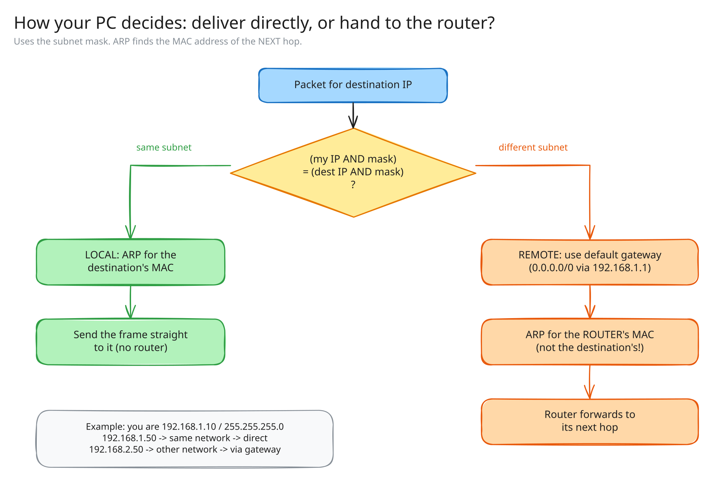

**How to read the diagram.** Start at the top with a packet for some destination IP. Compute `(my IP AND mask)` and `(destination IP AND mask)` and compare:

- **Same result → local.** The destination is on my network. My PC asks the network (ARP, below) for the *destination's* MAC address and sends the frame straight to it. No router.
- **Different result → remote.** My PC uses the default gateway and asks for the *router's* MAC address, not the destination's. The router forwards it to its next hop.

Worked example: you are `192.168.1.10` with mask `255.255.255.0`. For `192.168.1.50` both sides give `192.168.1.0`, so deliver directly. For `192.168.2.50` they differ, so go via the gateway.

<details>
<summary><strong>What is ARP?</strong></summary>

A PC that knows a destination *IP* still cannot build an Ethernet frame, which needs the destination *MAC*. **ARP** (Address Resolution Protocol) bridges that gap:

1. **Ask:** the PC broadcasts to the local network: "Who has `192.168.1.50`? Tell `192.168.1.10`."
2. **Answer:** the owner replies: "I do. My MAC is `AA:BB:CC:DD:EE:FF`."
3. **Remember:** the PC keeps the pair in its ARP cache so it does not ask again immediately.

ARP only works within one local network, which is why a remote destination makes the PC ARP for the *router* instead. Remember ARP: the overlay-network section later relies on a trick built on it.

</details>

### What changes at each hop, and what does not

Layer 3 (IP) addresses stay constant; Layer 2 (MAC) addresses change at every hop.

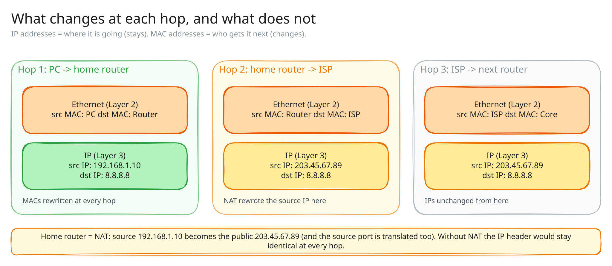

**How to read the diagram.** Three columns are three hops. In each the Ethernet header (top) shows a new pair of MAC addresses: *who gets it next*. The IP header (bottom) shows *where it is going*. In hop 1 the source IP is the PC's private `192.168.1.10`. The home router performs **NAT** and writes its public address `203.45.67.89` into the source field; from hop 2 onward the IP header no longer changes. Without NAT the IP header would be identical at every hop.

The same router, in text:

```
At your PC:
  [Ethernet] Src MAC: PC      -> Dst MAC: your router
  [IP]       Src IP: 192.168.1.10 -> Dst IP: 8.8.8.8

At your router (first hop), after NAT:
  [Ethernet] Src MAC: router  -> Dst MAC: ISP router
  [IP]       Src IP: 203.45.67.89 (rewritten by NAT) -> Dst IP: 8.8.8.8
```

### How do response packets get back to you?

A common question: "My packet reached Google at `8.8.8.8`. How does the reply find me?"

<details>
<summary><strong>It follows the same hop-by-hop process in reverse.</strong></summary>

1. **Google's server** receives your request and builds a reply addressed to **your public IP**.
2. It hands that to its own default gateway.
3. Each router on the Internet backbone checks its table and forwards the packet toward your ISP.
4. **Your ISP** recognises your public IP and forwards the packet to your **home router**.
5. **Your home router** remembers (NAT, next section) which inside device made the request, rewrites the destination from public to private (`192.168.1.10`) and forwards it to you.

**Key takeaway:** routing is bidirectional but independent. The path back can differ from the path there.

</details>

### Three situations, one of them ours

Now that we know how routing works, here are the three cases from the start of section 4B:

- **Case 1: same LAN.** Local delivery: direct, as in the "local" branch above.
- **Case 2: public IPs.** Remote delivery: routing tables and hops.
- **Case 3: private IPs behind NAT** (your router, your ISP, or both). **This is our case.**

Cases 1 and 2 need nothing more than what we have covered. Case 3 has a problem, and the next section explains it.

---

## 4E. Case 3: the private IP problem

**Discover it yourself.**

1. Run `ipconfig` (Windows) or `ifconfig` / `ip addr` (macOS, Linux). You will see something like `192.168.1.10` or `10.0.0.5`.
2. Search "what is my IP" in a browser. You will see something completely different, such as `203.45.67.89`.

Your computer says it has one address and the Internet sees another. The difference is **NAT (Network Address Translation)**.

**Why NAT exists.** IPv4 addresses are 32 bits, so there are about 4.3 billion. With far more connected devices than that, public IPv4 addresses ran out. The permanent fix is **IPv6** (128-bit addresses), but most home networks still depend on IPv4. The stop-gap is to give each home *one* public address and let every device inside use a **private address** (`10.x.x.x`, `172.16-31.x.x`, `192.168.x.x`), which Internet routers refuse to forward. The home router translates between the two. The companion article, section 1, lists these ranges and walks through NAT packet by packet.

```text
Your home network:
  Router  (public IP 203.45.67.89)   <- all the Internet ever sees
    |-- NAT translation table
    |-- Your PC     192.168.1.10
    |-- Your phone  192.168.1.11
    |-- Your tablet 192.168.1.12
    `-- Smart TV    192.168.1.13
```

All four devices share one public IP when they talk to the Internet.

The essential consequence, which the companion article proves in detail: *NAT only creates a translation entry when a device inside sends a packet out.* A packet arriving from outside with no entry has nowhere to go and is dropped. So **nobody can start a conversation with a PC behind NAT.** And behind **CGNAT** (the `100.72.0.1` hop in our traceroute) there are two such NATs in a row, one of them in your ISP's equipment, so even opening a port on your own router changes nothing.

### The way out for us: Tailscale

All our friends' PCs are behind NAT (Case 3), so they are invisible to each other. A private address like `192.168.1.10` only exists inside its own home, so nobody else can dial it.

**Mesh VPNs such as Tailscale** solve this. Tailscale creates a virtual network on top of the real one and gives every device a stable address in the `100.x.y.z` range (the `100.64.0.0/10` block). Those addresses are routable *inside the tailnet* wherever the devices physically are. Behind the scenes, devices find each other through a coordination server, punch holes through their NATs at the same moment, and fall back to relays when they cannot.

For the Swarm story, the key point is: Tailscale gives every machine a stable `100.x.y.z` address that every other machine can reach. That checks off our first requirement, a routable mesh. The full mechanism (STUN, hole punching, DERP relays, the TUN device) is in the [companion article](tailscale-nat-deep-dive.md).

---

## 5. Swarm networking: ports, protocols and who talks to whom

Now that every node can be given a reachable address, we need to know *what traffic* Swarm actually sends, so that we can allow exactly that. Swarm uses four channels. Three use fixed ports.

> **Reading note.** This section mentions *VXLAN*, *ingress* and *IPVS* before they are explained in full. For now, treat them as "the mechanism that carries container traffic between machines"; sections 6 to 9 build them up from scratch.

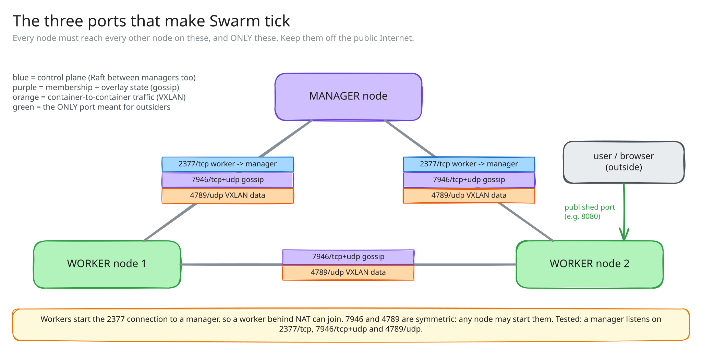

**How to read the diagram.** Blue is the control plane (`2377/tcp`), purple is gossip (`7946/tcp+udp`), orange is container traffic (`4789/udp`), green is the only port meant for outsiders (a *published* service port, e.g. `8080`). Arrows start where the connection is initiated. Workers open the `2377` connection *to a manager*, which is why a worker behind NAT can join. `7946` and `4789` are symmetric: any node may start them. The footnote records what was observed: a real manager listens on exactly `2377/tcp`, `7946/tcp+udp` and `4789/udp`.

### 5.1 Control plane: TCP 2377

All control traffic between managers and workers runs over **TCP 2377**. A joining worker opens one persistent, TLS-encrypted connection to a manager. It carries:

- join and leave events,
- task assignments (which container runs where),
- node health updates.

Only managers listen on 2377, and workers connect to managers, not the other way around. If 2377 is blocked, workers cannot receive tasks and the swarm stops working.

### 5.2 Gossip: UDP and TCP 7946

Swarm uses a **gossip protocol** (SWIM-based: Scalable Weakly-consistent Infection-style Membership) to spread membership and overlay-network information to *every* node, workers included.

**What gossip solves.** In a large cluster, broadcasting every change from one source is expensive and fragile. Instead each node periodically tells a few random peers what it knows, and those peers repeat it.

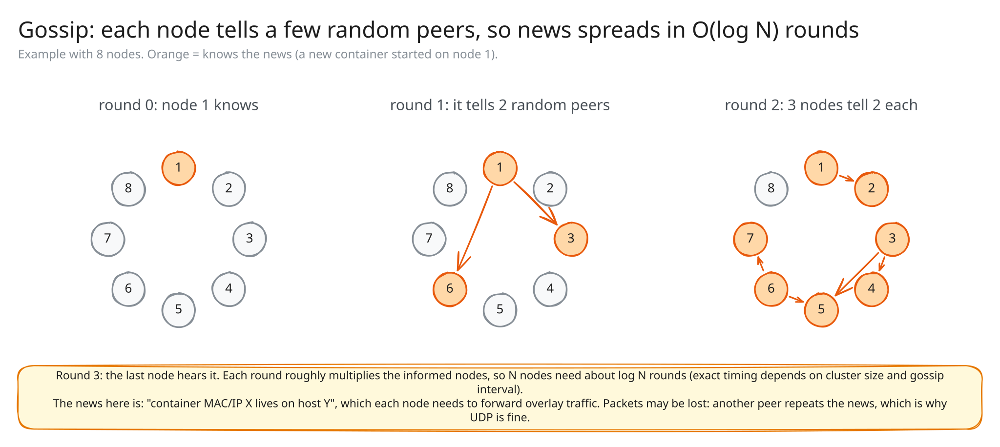

**How to read the diagram.** Eight nodes. In round 0 only node 1 knows the news (for example, "a new container started on node 1"). In round 1 it tells two random peers. In round 2 those three tell two each. By round 3 the last node has heard. Each round roughly multiplies the informed nodes, so N nodes need on the order of log N rounds (the exact timing depends on cluster size and the gossip interval). Spreading along a *chain* would take N steps; fan-out is the point.

**What travels on this channel:**

- node join/leave events,
- node health and reachability,
- **overlay endpoint information**: "container MAC/IP X lives on host Y", which each node needs to forward container traffic (sections 7.2 and 9.2).

**TCP 7946** is also used, for a full state transfer (for example when a node rejoins after a network partition).

> **Why UDP?** Gossip tolerates lost messages: if one is dropped, another peer repeats the information shortly after.

### 5.3 Raft: agreement among managers (inside TCP 2377)

Managers must agree on the cluster's authoritative state: which services exist, how many replicas, which nodes are healthy. Swarm uses the **Raft consensus algorithm**.

- One manager is elected **leader**. All writes (service updates, scaling) go through it.
- The leader replicates each change to the other managers and commits it once a **quorum** (a majority, `floor(N/2) + 1`) has it.
- If the leader becomes unreachable, the remaining managers hold an election.
- Raft prevents **split brain**: two halves of a partitioned cluster each believing they are in charge and making conflicting decisions. Without a majority the cluster refuses changes.

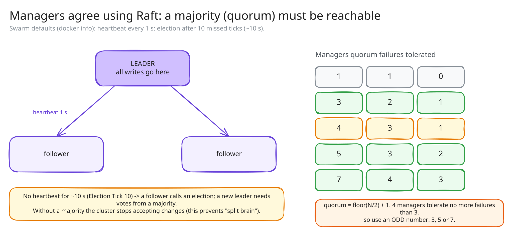

**How to read the diagram.** The leader sends heartbeats to followers. The table shows how many managers you need and how many failures you can survive: 3 managers need 2 and survive 1; 5 need 3 and survive 2; **4 managers still survive only 1**, no better than 3. Hence: use an odd number, 3, 5 or 7. The bottom note gives Swarm's real timing: `docker info` shows heartbeat tick 1 and election tick 10, and Swarm's tick is 1 second, so followers call an election after about **10 seconds** without heartbeats (not the 150–300 ms of the original Raft paper).

Raft shares the same TCP 2377 connections; it is a logical layer, not a separate port.

### 5.4 Container-to-container traffic: UDP 4789

When containers on different machines need to talk, Swarm uses **VXLAN** over **UDP 4789**. VXLAN wraps a container's whole Ethernet frame inside a UDP packet so it can cross the real network, and unwraps it at the far end so the container thinks the other container is on the same local network. Containers use their *overlay* addresses (for example `10.0.1.x`) and need to know nothing about the physical network. This channel carries service-to-service traffic across nodes and the ingress mesh traffic below. (Section 8 builds it from scratch.)

### 5.5 Ingress and the routing mesh: published ports

The **routing mesh** lets *any* node accept traffic for a **published port**, even if that node runs no replica of the service. The node forwards the request to a node that does have a healthy replica.

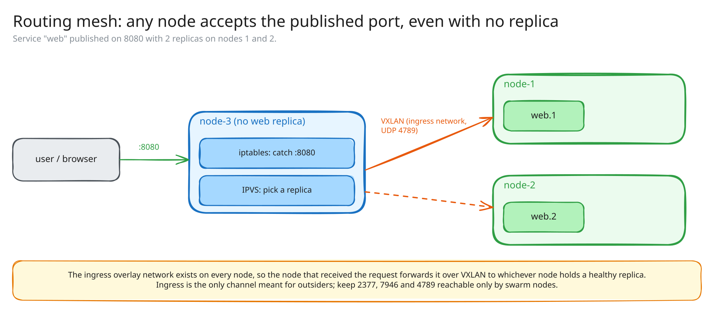

**How to read the diagram.** Service `web` is published on `8080` with replicas on node 1 and node 2. A user connects to node 3, which runs no replica. Node 3's `iptables` rules catch `:8080`, an **IPVS** load balancer (a Linux kernel feature that picks a backend for each connection) chooses a replica, and the request travels over the **ingress overlay network** via VXLAN (UDP 4789) to the chosen node. Because the ingress network exists on every node, every node can accept the request. This is the only channel meant for outsiders; everything else should be reachable by swarm nodes only.

Publishing a port is cluster-wide: a published port is claimed on *every* node by the ingress network, so two services cannot publish the same port at the same time. We hit this exact limit in the hands-on section.

### Reference tables

| Port | Protocol | Purpose |
| --- | --- | --- |
| 2377 | TCP | Manager control plane (and Raft), manager-only listener |
| 7946 | TCP + UDP | Gossip: membership, overlay endpoint info; TCP for full state sync |
| 4789 | UDP | VXLAN: container-to-container traffic across hosts |
| published ports | TCP / UDP | Routing-mesh access for outsiders |

| Pattern | Protocol | Participants | Purpose |
| --- | --- | --- | --- |
| Raft | TCP (in 2377) | managers only | agreement on state |
| Control plane | TCP 2377 | manager ↔ worker | task assignment, coordination |
| Gossip | UDP/TCP 7946 | all nodes | membership, health, endpoint discovery |
| Overlay | UDP 4789 | all nodes | container-to-container traffic |
| Routing mesh | IPVS + VXLAN | all nodes | external traffic in |

<details>
<summary><b>Patterns worth calling out (important for firewalls)</b></summary>

**Raft heartbeats are unsolicited from the follower's point of view.** The leader sends them on its own schedule; followers do not ask. A follower that hears none for the election timeout assumes the leader is dead and triggers an election. So your firewall must allow inbound TCP 2377 *between managers*, not only from workers.

**Gossip is symmetric and unpredictable in direction.** Any node can push to any other at any time. UDP 7946 must therefore be open in both directions between *all* nodes, not just manager and worker.

**VXLAN looks bidirectional to the physical network.** A firewall sees UDP 4789 flowing both ways between hosts, with a whole Ethernet frame inside each packet. Stateful firewalls generally handle it; stateless ACLs need explicit rules for both directions.

**Ingress is the only channel that accepts traffic from outside the cluster.** Restrict 2377, 7946 and 4789 to swarm nodes only, and expose only your published ports to outsiders. In our setup the Tailscale interface is what enforces that boundary (section 14C).

</details>

---
## 6. Containers and overlay networks: from isolation to cross-host communication

Section 5 described the traffic Swarm sends between nodes. Now we explain the part that surprises people: how a *container* on one machine reaches a *container* on another. For that we first need to know what a container is.

### 6.1 What is a container?

A container is **not a virtual machine**. It does not boot its own operating system or run its own kernel. (The **kernel** is the core of an operating system: the part that manages memory, processes, devices and the network.) A container is an ordinary **process, or group of processes, running on the host's kernel**, with a restricted view of the system and a budget for resources.

A **virtual machine (VM)** is the opposite: software pretends to be a whole computer, and a **hypervisor** (Hyper-V, KVM) runs a complete guest operating system, with its own kernel, on top of it.

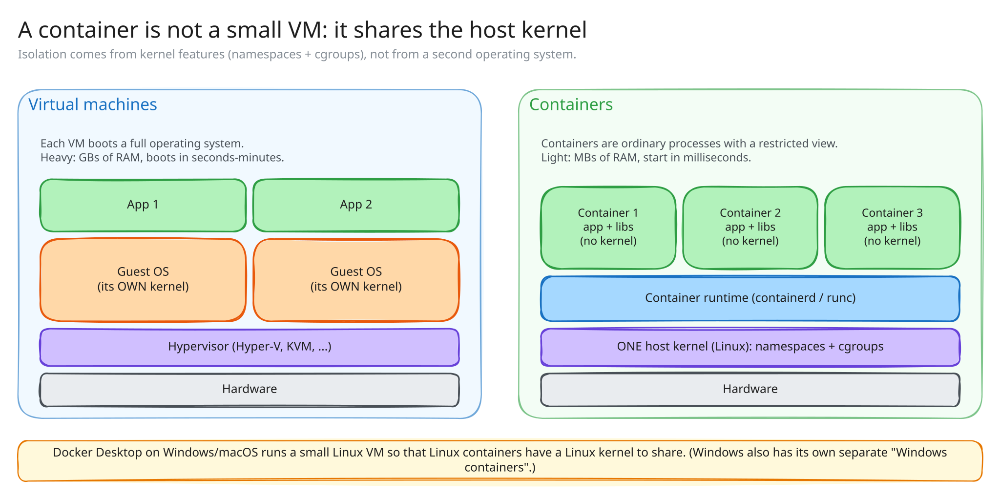

**How to read the diagram.** Left, virtual machines: each VM stacks an application on a full guest OS (its own kernel) on a hypervisor on the hardware. That is heavy: gigabytes of memory, seconds to minutes to boot. Right, containers: each container is an app plus its libraries with *no* kernel of its own, all sharing **one** host kernel, with isolation done by kernel features (namespaces and cgroups, next). That is light: megabytes, milliseconds. The footnote is why this matters to us: **Linux containers need a Linux kernel**, so Docker Desktop on Windows or macOS quietly runs a small Linux VM to provide one. (Windows also has separate *Windows containers*, which share the Windows kernel; this series is only about Linux containers.)

### 6.2 Namespaces and cgroups: the two kernel features behind containers

- **Namespaces** change what a process can **see**: its own process list, its own network, its own filesystem.
- **cgroups (control groups)** limit what a process can **use**: CPU, memory, disk I/O.

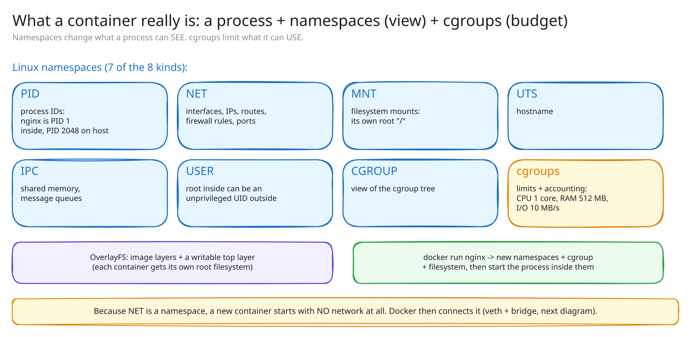

**How to read the diagram.** Each tile is a namespace type, with what it isolates:

| Namespace | What it isolates | Effect |
| --- | --- | --- |
| **PID** | process IDs | nginx is PID 1 inside; PID 2048 on the host. It cannot see host processes |
| **NET** | interfaces, IP addresses, routing table, firewall rules, ports | each container has its own network stack and can bind port 80 without clashing |
| **MNT** | filesystem mounts | the container has its own root `/`; changes do not touch the host |
| **UTS** | hostname | each container has its own hostname |
| **IPC** | shared memory, message queues | containers cannot interfere with each other's |
| **USER** | user IDs | root (UID 0) inside can be an unprivileged UID outside |
| **CGROUP** | the view of the cgroup tree | containers see only their own limits |

The **cgroups** tile is the budget: for example 1 CPU core, 512 MB of RAM, 10 MB/s of I/O. They stop one container from starving the rest. The bottom strip is **OverlayFS**, a layered filesystem: read-only image layers with one writable layer on top, so every container gets its own root filesystem cheaply. (Do not confuse OverlayFS, a *filesystem*, with an *overlay network*, which comes later.)

**What `docker run nginx` does:** it asks the Docker **daemon** (`dockerd`, the background program that does the work; the `docker` command only talks to it) to create new namespaces and a cgroup, set up the filesystem, then start the nginx process inside them. Nginx believes it is the only process, has its own network card `eth0`, and has its own `/`.

**The line to remember, from the note at the bottom of the diagram:** because NET is a namespace, a new container starts with **no network at all**. Docker has to connect it.

### 6.3 How does one container talk to another on the same host?

A new network namespace is empty: no interfaces to the outside, nothing to reach. Docker gives it a connection with two Linux building blocks:

- A **veth pair** (virtual Ethernet pair): two interfaces joined like the two ends of a cable. A frame that goes in one end comes out the other. Docker puts one end *inside* the container's namespace (it appears as `eth0`) and leaves the other end in the host namespace.
- A **bridge**: a virtual switch inside the kernel. Docker's default bridge is called `docker0` (`172.17.0.1`). It joins the host-side end of every container's veth pair, and switches frames between them by MAC address.

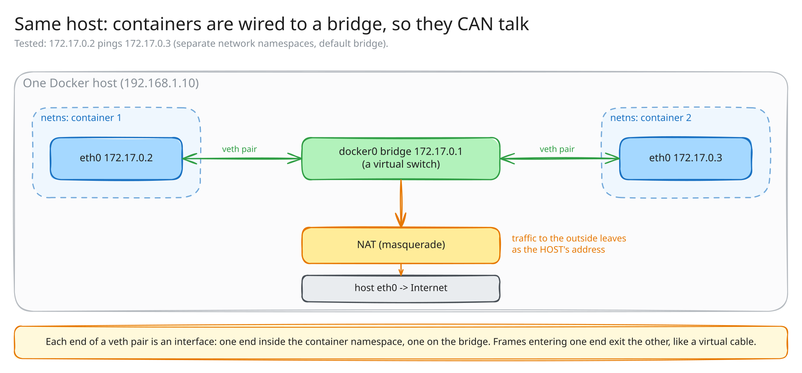

**How to read the diagram.** Two containers sit in separate network namespaces, `172.17.0.2` and `172.17.0.3`. Each has a veth pair; the other ends plug into the `docker0` bridge, a virtual switch. Frames from one container reach the other through the bridge. Traffic for the Internet goes out through the host's own network card after NAT (masquerade), leaving as the *host's* address.

> **Observed, Docker 29.9.2:** from a container at `172.17.0.2`, a ping to `172.17.0.3` (separate network namespaces, default bridge) got 2 of 2 replies. Containers on the same host **can** talk, by IP address, on the default bridge. Namespaces alone give no connectivity; `docker0` supplies it. (Docker's own documentation says the same: on the default bridge, containers reach each other by IP address.)

So on one host the problem is solved by a veth pair and a bridge. The interesting question is what happens with a second host.

### 6.4 The cross-host challenge

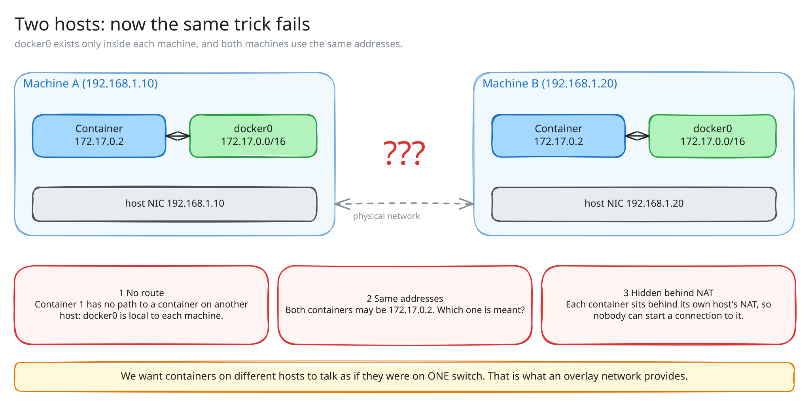

**How to read the diagram.** Machine A (`192.168.1.10`) and Machine B (`192.168.1.20`) each have their own `docker0` and their own container, and both containers may well be `172.17.0.2`. The question mark between them is the problem, in three parts:

1. **No route.** `docker0` exists only inside each machine. Container 1 has no path to a container on another host.
2. **Same addresses.** Both containers may be `172.17.0.2`. A packet to `172.17.0.2` is ambiguous: which one?
3. **Hidden behind NAT.** Each container sits behind its own host's NAT (the masquerade in 6.3), so nobody outside can start a connection to it. This is the NAT problem from section 4E, one level down.

**The question:** how can Container-1 on Machine A talk to Container-2 on Machine B as if they were on **one** switch?

### 6.5 The solution: an overlay network

An **overlay network** is a virtual network built *on top of* an existing physical network, which is called the **underlay**. It hides the physical network and presents containers on different machines with one shared virtual LAN.

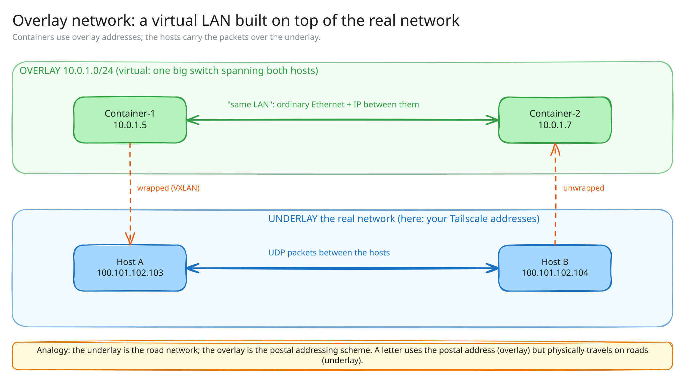

**How to read the diagram.**

- **Top (overlay):** two containers, `10.0.1.5` and `10.0.1.7`, appear to sit on one local network: ordinary Ethernet and IP between them, same subnet `10.0.1.0/24`.
- **Bottom (underlay):** the real network. Here the hosts use their Tailscale addresses (`100.101.102.103` and `100.101.102.104`), but any reachable address works.
- **The arrows in between:** the sending host *wraps* the container's frame in a packet addressed to the other host, and the receiving host *unwraps* it. Between the hosts, only ordinary UDP packets exist.

An analogy: the underlay is the road network, the overlay is the postal addressing scheme. A letter uses the postal address but physically travels on roads.

Docker Swarm overlay networks:

- **span multiple hosts** in the swarm,
- provide **Layer 2** (Ethernet) connectivity between containers,
- **isolate** different services on separate overlay networks,
- give containers **service discovery** through an embedded DNS (a container can reach another by service name).

---

## 7. How Swarm sets up its networks

### 7.1 What `docker swarm init` creates

```bash
# On the first manager
docker swarm init --advertise-addr 100.101.102.103   # a Tailscale address in our setup
```

`--advertise-addr` is the address that other nodes are told to use to reach this node. Everything in the swarm uses it, so it must be reachable by every node (in our setup: the Tailscale address).

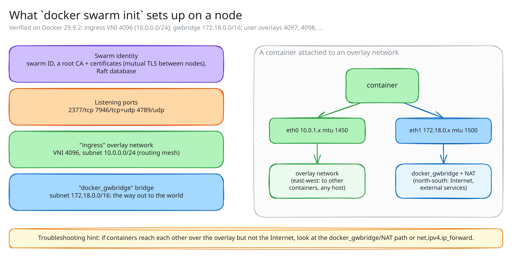

**How to read the diagram.**

- **Swarm identity (top left):** a unique swarm ID, a root certificate authority (CA) that issues certificates so nodes authenticate each other with mutual TLS, and the Raft database.
- **Listening ports:** `2377/tcp`, `7946/tcp+udp`, `4789/udp`.
- **The `ingress` overlay network:** created automatically. Observed on Docker 29.9.2: VNI **4096**, subnet `10.0.0.0/24`. It carries the routing-mesh traffic from section 5.5.
- **`docker_gwbridge`:** a local bridge, subnet `172.18.0.0/16`. It is the container's way out to the world.
- **A container on an overlay network (right):** it gets **two** interfaces. `eth0` (e.g. `10.0.1.x`, MTU 1450) is on the overlay: east-west traffic to other containers on any host. `eth1` (`172.18.0.x`) is on `docker_gwbridge`: north-south traffic to the Internet and external services, NATed out.
- **Gossip** also starts (section 5.2).

Networks you create yourself get the next subnets and VNIs: observed, the first user overlay was `10.0.1.0/24`, VNI 4097; the second `10.0.2.0/24`, VNI 4098.

**Troubleshooting hint** (the note under the diagram): if containers reach each other over the overlay but not the Internet, the fault is almost always in the `docker_gwbridge` path: a missing NAT rule, a misconfigured bridge, or host IP forwarding disabled (`net.ipv4.ip_forward = 0`).

```bash
docker network inspect docker_gwbridge
# Name: docker_gwbridge, Driver: bridge, Subnet 172.18.0.0/16, Gateway 172.18.0.1
```

### 7.2 IP address management

Swarm has a built-in **IPAM** (IP Address Management) that gives each overlay network its own subnet and each container an address in it:

```text
Overlay "frontend"   10.0.1.0/24   gateway 10.0.1.1   containers 10.0.1.2 - 10.0.1.254
Overlay "backend"    10.0.2.0/24   gateway 10.0.2.1   containers 10.0.2.2 - 10.0.2.254
Overlay "database"   10.0.3.0/24   gateway 10.0.3.1   containers 10.0.3.2 - 10.0.3.254
```

When a service gets its replicas, each container is assigned an address on the overlay, and *every node learns where it lives*:

```text
web-app.1 (worker-1) -> 10.0.1.5     "10.0.1.5 is on worker-1 (100.101.102.103)"
web-app.2 (worker-2) -> 10.0.1.7     "10.0.1.7 is on worker-2 (100.101.102.104)"
web-app.3 (worker-3) -> 10.0.1.9     "10.0.1.9 is on worker-3 (100.101.102.105)"
```

Docker spreads those mappings with the **gossip** protocol from section 5.2: when `web-app.1` starts on worker-1 and takes `10.0.1.5`, worker-1 tells a few random peers "10.0.1.5 has MAC `aa:bb:cc:dd:ee:ff` and lives on this host", those peers repeat it, and within a few rounds (a few seconds in a small cluster) every node can route to it. Gossip carries membership, container placement, overlay membership and the **IP-to-host mappings** that VXLAN needs.

> **Why a few seconds is plausible but untested.** Gossip timing depends on cluster size and interval, and I only had a single-node swarm. Treat "a few seconds" as expected behaviour, not a measurement.

---

## 8. VXLAN: Virtual Extensible LAN

We now know the *what* (overlay networks) and *why* (cross-host container communication). The *how* is **VXLAN**.

**VXLAN** is a technology that **wraps Layer-2 Ethernet frames inside Layer-4 UDP packets**. Its purpose: let a Layer-2 network (an Ethernet segment) span a Layer-3 network (routed IP). In the language of the companion article's section 2: it is a **tunnel**, like the VPN's, but carrying *Ethernet frames* between containers instead of IP packets between PCs.

Four terms to carry through the next sections:

1. **VNI (VXLAN Network Identifier):** a 24-bit number naming one overlay network. About 16 million values, versus 4,096 for the older VLAN IDs.
2. **VTEP (VXLAN Tunnel Endpoint):** the device that wraps and unwraps. In Swarm, each host's kernel is the VTEP for the overlay networks it takes part in.
3. **Underlay:** the real IP network that carries the wrapped packets.
4. **Overlay:** the virtual Layer-2 network VXLAN creates.

### 8.1 MAC-in-UDP encapsulation

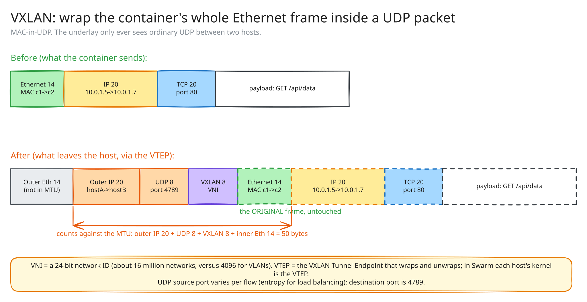

**How to read the diagram.** The top row is what the container sends: an Ethernet header (MAC of container 1 to container 2), an IP header (`10.0.1.5` to `10.0.1.7`), a TCP header (port 80) and the payload (`GET /api/data`). The bottom row is what leaves the host: the same row, **untouched**, preceded by four new headers: an outer Ethernet header, an outer **IP** header (host A to host B), a **UDP** header (destination port **4789**; the source port varies per flow so network equipment can load-balance), and an 8-byte **VXLAN** header that carries the VNI.

The original frame is completely preserved inside the UDP payload; the receiving VTEP extracts it unchanged.

**The cost, shown at the bottom of the diagram:** outer IP 20 + UDP 8 + VXLAN 8 + inner Ethernet 14 = **50 bytes** of overhead that count against the MTU (the outer Ethernet header is added by the host's own NIC and is not part of the MTU). Section 14D turns this into a concrete setting.

### 8.2 VNI: who picks the number?

Docker assigns VNIs automatically when overlay networks are created, counting upward from 4096.

```text
Network created        VNI assigned (Docker 29.9.2, observed)
ingress (built in)  -> 4096
docker_gwbridge     -> none (a local bridge, not VXLAN)
first user overlay  -> 4097
second user overlay -> 4098
...and so on
```

Check it yourself (this reads a Docker option, so it works on the host):

```bash
docker network inspect ingress -f '{{index .Options "com.docker.network.driver.overlay.vxlanid_list"}}'
docker network inspect frontend -f '{{index .Options "com.docker.network.driver.overlay.vxlanid_list"}}'
```

> **Version note.** These numbers are from Docker 29.9.2. Older engines may start the numbering elsewhere, so read the value rather than assuming it.

**Why the VNI matters: isolation.** Containers on different overlay networks can sit on the same hosts, but their VXLAN packets carry different VNIs. A VTEP reads the VNI before unwrapping, and discards the packet if no local overlay network has that VNI. That check is what keeps a `frontend` overlay separate from a `backend` overlay even though both use UDP 4789 on the same links.

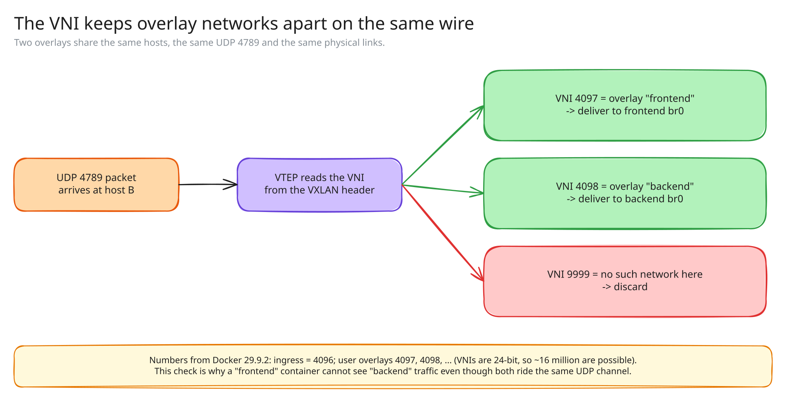

**How to read the diagram.** A UDP 4789 packet arrives at host B. The VTEP reads the VNI from the VXLAN header: **4097** is "frontend", so it is delivered to the frontend bridge; **4098** is "backend", delivered to the backend bridge; **9999** matches nothing, so it is discarded.

### 8.3 The VTEP: what it does

A VTEP:

- **encapsulates:** wraps overlay frames in VXLAN, UDP, IP and Ethernet headers;
- **decapsulates:** pulls the original frame out;
- **knows where remote containers are:** it keeps a table from container MAC addresses to the host that owns them. In Swarm, Docker fills this table from its gossip-fed peer database rather than letting the kernel learn it from traffic;
- **proxies ARP:** it answers "who has `10.0.1.7`?" on behalf of the remote container, so ARP never has to cross the tunnel (explained in 9.3).

---

## 9. Inside a host: the real interfaces, and how the VTEP finds remote containers

### 9.1 What Docker actually builds on each host

When a host joins an overlay network, Docker builds a small network inside the host. It does **not** put the VXLAN device in the host's own network namespace. Each overlay network gets its **own** network namespace (a file such as `/var/run/docker/netns/1-<id>`), holding a bridge and a VXLAN device.

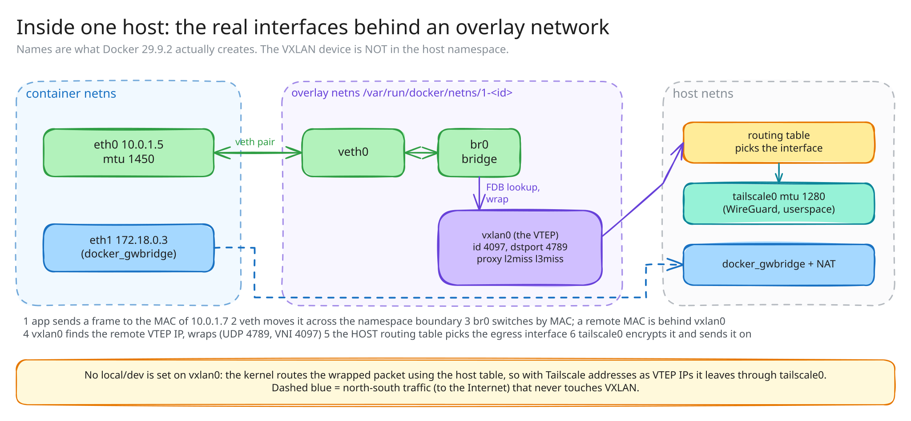

**How to read the diagram.** Three boxes are three network namespaces on one host. Names are the ones Docker 29.9.2 actually creates.

- **Left, container namespace:** `eth0` (`10.0.1.5`, MTU 1450) is the overlay interface; `eth1` (`172.18.0.3`) is the `docker_gwbridge` interface for north-south traffic (the dashed blue line, which never touches VXLAN).
- **Middle, overlay namespace** (`/var/run/docker/netns/1-<id>`): a bridge `br0` (the virtual switch) and `vxlan0`, the VTEP, with `id 4097`, `dstport 4789` and the flags `proxy l2miss l3miss`. The container's veth pair ends here, on `br0`.
- **Right, host namespace:** the host's routing table, and, in our setup, `tailscale0` (MTU 1280, WireGuard in user space) and `docker_gwbridge` with NAT.

**The six steps along the bottom:**

1. The app sends a frame to the MAC of `10.0.1.7`.
2. The veth pair moves it across the namespace boundary.
3. `br0` switches by MAC; a *remote* MAC is "behind" `vxlan0`.
4. `vxlan0` finds the remote VTEP's IP and wraps the frame (UDP 4789, VNI 4097).
5. The **host's** routing table chooses the egress interface.
6. `tailscale0` encrypts it and sends it on.

**A detail worth noticing** (the note at the bottom of the diagram): `vxlan0` has no fixed `local` address or `dev` bound. The kernel routes the wrapped packet using the host's routing table. So when the VTEP addresses are Tailscale addresses, the wrapped packet leaves through `tailscale0`. That is exactly why this setup works.

**How to look at it yourself.** Because these devices live in another namespace, `ip link` on the host will *not* show them. Enter the namespace first (as root):

```bash
sudo ls /var/run/docker/netns                              # 1-<id> files = overlay networks
sudo nsenter --net=/var/run/docker/netns/1-<id> ip -d link show vxlan0
sudo nsenter --net=/var/run/docker/netns/1-<id> ip -d link show br0
```

A real device looks like this (observed, trimmed):

```text
vxlan0: ... vxlan id 4097 ... dstport 4789 proxy l2miss l3miss ttl auto ageing 300
```

| Field | Meaning |
| --- | --- |
| `vxlan id 4097` | the VNI of this overlay network |
| `dstport 4789` | the standard VXLAN UDP port |
| `proxy` | the VTEP answers ARP requests itself (9.3) |
| `l2miss`, `l3miss` | if the kernel cannot find a MAC or ARP answer, report the miss so Docker can react |
| `ageing 300` | entries the kernel learns by itself expire after 300 s |

> **Correction to a common description.** You will see articles (including an earlier version of this one) claim the VXLAN device runs with a `nolearning` flag and is pinned with `local <ip> dev eth0`. On Docker 29.9.2 it is neither: the flags are the ones above, and Docker's driver creates the device with learning on. The interface is named `vxlan0` inside the overlay namespace (Docker's source builds a longer name like `vx-001001-…`, but the interface it creates is `vxlan0`).

### 9.2 The FDB and the neighbour table: how a VTEP knows who is where

The VTEP has to answer two questions for every frame:

1. **"Which host owns this MAC address?"** Answered by the **FDB** (forwarding database), a kernel table mapping *container MAC → remote VTEP IP*.
2. **"What MAC does this overlay IP have?"** Answered by the **neighbour table** (the kernel's ARP cache).

Docker fills both from its **peer database**, which is fed by gossip. Nobody has to guess.

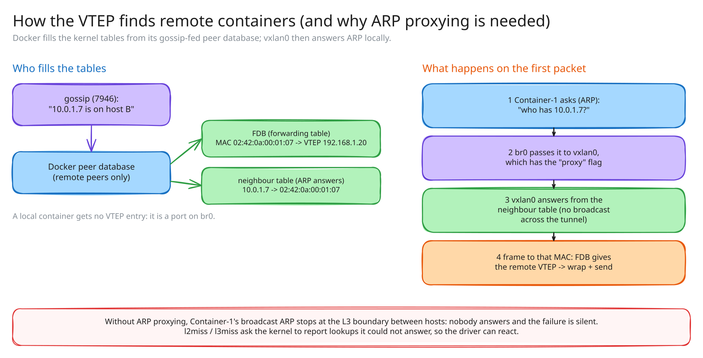

**How to read the diagram.** Left column, *who fills the tables*: gossip on 7946 announces "10.0.1.7 is on host B"; Docker's peer database turns that into an **FDB** entry (`MAC 02:42:0a:00:01:07 → VTEP 100.101.102.104`) and a **neighbour** entry (`10.0.1.7 → 02:42:0a:00:01:07`). Only *remote* peers get entries: a local container needs none, because it is simply a port on `br0`.

Right column, *the first packet*:

1. Container-1 asks (ARP): "who has `10.0.1.7`?"
2. `br0` passes it to `vxlan0`, which has the `proxy` flag.
3. `vxlan0` answers from the neighbour table. No broadcast crosses the tunnel.
4. Container-1 now sends a frame to that MAC; the FDB gives the remote VTEP, and the frame is wrapped and sent.

Looking at the tables (inside the overlay namespace):

```bash
sudo nsenter --net=/var/run/docker/netns/1-<id> bridge fdb show dev vxlan0
sudo nsenter --net=/var/run/docker/netns/1-<id> ip neigh show
```

Illustrative output on host A for the three-node example in 7.2 (the FDB lists **remote** peers only):

```text
02:42:0a:00:01:07 dst 100.101.102.104 self permanent     # web-app.2, on worker-2
02:42:0a:00:01:09 dst 100.101.102.105 self permanent     # web-app.3, on worker-3
```

> **Not verified.** I only had a single-node swarm, so I have not captured real FDB entries from a multi-node cluster. The table above shows what the design implies, not a recording. The gossip-fed population is described in Docker's driver source; take the exact output formatting as illustrative.

**How an entry appears.** When `web-app.2` starts on worker-2, Docker assigns it IP `10.0.1.7` and MAC `02:42:0a:00:01:07` (Docker derives the MAC from the IP: `0a 00 01 07` is `10.0.1.7` in hex). Worker-2 gossips "MAC `02:42:0a:00:01:07` is at VTEP `100.101.102.104`". Every other node adds an FDB entry and a neighbour entry before any traffic flows.

> **Why not let the kernel learn MACs from traffic?** Kernel learning only starts after a first packet arrives from a peer, and an entry for a container that moved hosts would stay stale until it ages out (300 s by default). Filling the tables in advance from gossip avoids both. *That rationale is my inference; I did not find it stated in Docker's documentation.* The `l2miss` and `l3miss` flags are the other half of the design: if a lookup ever misses, the kernel tells Docker and Docker can answer.

### 9.3 Why the ARP proxy is needed

Before sending to `10.0.1.7`, Container-1's network stack needs its MAC address, so it broadcasts an ARP request:

```text
Dest MAC ff:ff:ff:ff:ff:ff (broadcast)   Src MAC 02:42:0a:00:01:05
Sender IP 10.0.1.5   Target IP 10.0.1.7   "Who has 10.0.1.7? Tell 10.0.1.5"
```

On a normal Ethernet segment every device hears it and the owner replies. **In an overlay this breaks.** The owner is in a different host, and ARP broadcasts are not routed across Layer-3 boundaries; the underlay between the hosts is a Layer-3 IP network.

```text
Without an ARP proxy:
Container-1 broadcasts ARP for 10.0.1.7
 -> the overlay bridge receives it
 -> no local port owns 10.0.1.7
 -> the request goes nowhere (L3 boundary)
 -> communication fails silently, before a single data packet is sent
```

This failure is confusing to diagnose: the routing and VXLAN configuration can be perfect, and ARP is the invisible prerequisite. The VTEP's **ARP proxy** intercepts the request and answers from the neighbour table that gossip filled (diagram in 9.2). No ARP broadcast ever crosses the tunnel.

---

## 10. The complete packet journey: Container-1 to Container-2

Setup: two hosts on one overlay.

```text
worker-1 (Tailscale 100.101.102.103):  Container-1  10.0.1.5   MAC 02:42:0a:00:01:05
worker-2 (Tailscale 100.101.102.104):  Container-2  10.0.1.7   MAC 02:42:0a:00:01:07
Overlay "frontend", VNI 4097
```

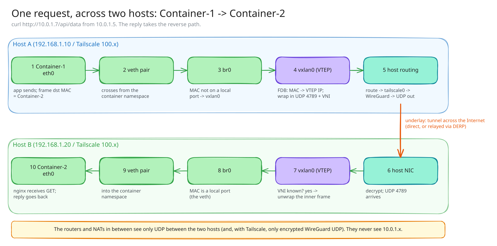

**How to read the diagram.** Host A on top, host B at the bottom, and between them the underlay. The numbers are the steps below. The note at the bottom is the point of the whole exercise: *the routers and NATs in the middle see only UDP between the two hosts (and, with Tailscale, only encrypted WireGuard UDP). They never see `10.0.1.x`.*

**Host A (sender)**

1. **The app sends.** Inside Container-1: `curl http://10.0.1.7/api/data`. The stack builds a frame with dest MAC `02:42:0a:00:01:07` (obtained via the ARP proxy in 9.3), source MAC `…:05`, dest IP `10.0.1.7`, TCP port 80.
2. **The veth pair.** Container `eth0` is one end of a veth pair; the frame exits the other end, in the overlay namespace. (A veth pair is a virtual cable: whatever enters one end exits the other.)
3. **`br0`.** The bridge looks up the destination MAC. It is not on any local port, so the bridge sends the frame towards `vxlan0`.
4. **`vxlan0`, the VTEP.** It asks the FDB: MAC `…:07` is at VTEP `100.101.102.104`. It wraps the frame: outer IP host A → host B, UDP port 4789, VNI 4097, original frame inside.
5. **Host routing.** The host's routing table says `100.101.102.104` goes via `tailscale0`. `tailscaled` encrypts the packet with WireGuard and sends it as UDP out of the real network card, direct or through a DERP relay (companion article, section 3).

**The underlay.** Routers, switches and NATs carry one encrypted UDP packet between host A and host B. They know nothing of containers.

**Host B (receiver)**

6. **Host NIC and Tailscale.** `tailscaled` decrypts and injects the packet; the kernel sees UDP port 4789 and hands it to the VXLAN device.
7. **`vxlan0` unwraps.** It checks the VNI (4097: a local overlay network, so accept), strips the outer Ethernet, IP, UDP and VXLAN headers, and reveals the original frame (Ethernet `…:05 → …:07`, IP `10.0.1.5 → 10.0.1.7`, TCP port 80).
8. **`br0`.** MAC `…:07` is a local port: the veth towards Container-2.
9. **The veth pair.** The frame crosses into the container's namespace.
10. **Container-2.** IP layer: destination `10.0.1.7` matches. TCP: port 80 is listening. nginx receives `GET /api/data HTTP/1.1` and sends the response.

**The return path** is the same chain in reverse: Container-2 `eth0` → veth → `br0` → `vxlan0` (wrap) → host routing → `tailscale0` → underlay → host A → `vxlan0` (unwrap) → `br0` → veth → Container-1.

---

## 11. Same host versus different hosts

What if Container-1 and Container-2 are on the **same** host? Then VXLAN is not involved at all: `br0` already has both containers as local ports.

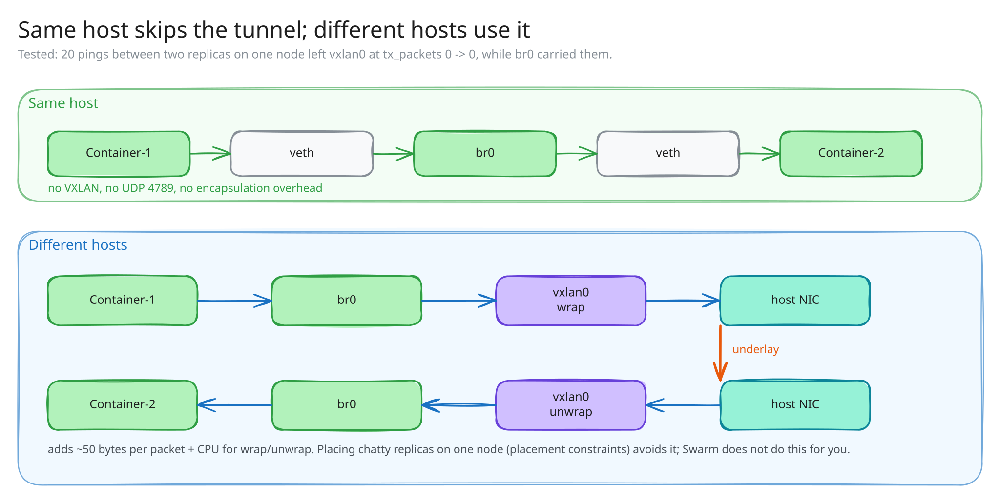

**How to read the diagram.** Top row (same host): Container-1 → veth → `br0` → veth → Container-2. The `br0` MAC table already has both MACs on local ports, so the frame is forwarded directly: no VXLAN, no UDP 4789, no encapsulation overhead. Bottom row (different hosts): the extra stages `vxlan0` wrap, host NIC, underlay, `vxlan0` unwrap. That path adds about 50 bytes to every packet plus CPU for wrapping and unwrapping.

> **Observed:** 20 pings between two replicas on one node left `vxlan0`'s `tx_packets` at 0 before and after, while `br0` carried them.

**The practical consequence.** If two chatty replicas must be fast, putting them on the same node removes the VXLAN cost. Swarm's scheduler does **not** do this for you; you have to ask for it with placement constraints.

---

## 12. Why this knowledge pays off

- **Troubleshooting.** When containers cannot talk, you can now ask: is it the container namespace? the veth pair? is the FDB populated? are VXLAN packets being wrapped and unwrapped? does the underlay route between the hosts?
- **Performance.** VXLAN adds ~50 bytes per packet (so the **MTU** must account for it: section 14D) and CPU for wrapping. It helps you decide where to place replicas.
- **Security.** Open UDP 4789 *only between swarm nodes* (section 14C). Understand where encryption applies: Swarm can encrypt overlay traffic itself with IPsec (`--opt encrypted`); here Tailscale already encrypts the underlay.
- **Debugging tools.** Because the devices live in the overlay namespace, enter it first:

```bash
# list namespaces
sudo ls /var/run/docker/netns
# interfaces, FDB and neighbours in an overlay namespace
sudo nsenter --net=/var/run/docker/netns/1-<id> ip -d link
sudo nsenter --net=/var/run/docker/netns/1-<id> bridge fdb show dev vxlan0
sudo nsenter --net=/var/run/docker/netns/1-<id> ip neigh show
# capture VXLAN traffic on the underlay interface (with Tailscale: tailscale0)
sudo tcpdump -ni tailscale0 'udp port 4789'
```

(`ip -d link show type vxlan` on the host prints nothing, because the device is not in the host namespace.)

### Summary: from isolation to communication

```text
[Starting point]  Containers are isolated by network namespaces; a namespace has no network until Docker wires it.
[On one host]     veth pair + bridge (docker0, or br0 for an overlay) connect containers.
[Across hosts]    Overlay network + VXLAN wrap Ethernet frames in UDP.
[Parts]
  1. Namespaces  -> isolation              4. VXLAN / VTEP -> the tunnel endpoint
  2. veth pairs  -> cross a namespace      5. FDB + neighbour table -> where things are
  3. Bridge      -> Layer-2 switching      6. Gossip -> distributes that knowledge
[Result]          Containers on different hosts reach each other as if on one LAN.
```

---
## 13. Can Docker Desktop be a Swarm node?

The original goal was to use the Docker Desktop that my friends already have. This section asks what we can actually say about that.

> **How to read this section.** Everything marked **Documented** comes from Docker's own documentation (the pages on Desktop networking, the platform FAQ and Windows permissions, read 2026-11-13). Everything marked **Hypothesis** is reasoning that I have **not tested**, because I had no Windows machine. The earlier version of this article stated several hypotheses as certainties ("impossible"). That was too strong, and it contradicted the README, which already says a default Docker Desktop/WSL2 setup *can* work if addresses, ports, the data path, firewall rules and MTU are deliberately configured. This version keeps facts and guesses visibly apart, and says how to settle the question.

### 13.1 The Linux prerequisite

**Linux containers need a Linux kernel.** They depend on features that exist in the Linux kernel: namespaces, cgroups, OverlayFS, netfilter/iptables, veth devices, bridges and VXLAN (sections 6 to 9). Windows and macOS kernels do not have these, so Docker Desktop on Windows or macOS must run a Linux environment. (Windows has its own *Windows containers*, a separate technology that this series does not use.)

### 13.2 WSL 2: a Linux kernel inside Windows

**WSL 2** (Windows Subsystem for Linux, version 2) runs a **real Linux kernel**, built by Microsoft, inside a lightweight virtual machine that Windows manages for you. It starts on demand and stops when idle. Windows files and Linux files can see each other.

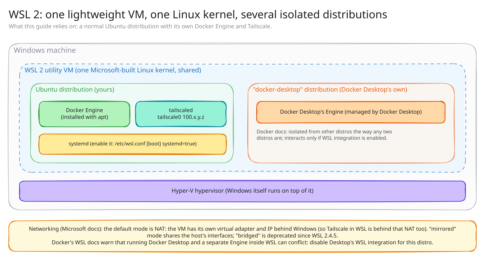

**How to read the diagram.**

- **Bottom:** the Hyper-V hypervisor, which Windows itself also runs on top of.
- **Middle:** one WSL 2 utility VM with **one** Microsoft-built Linux kernel, shared by every distribution.
- **Inside it, two distributions** side by side: **your Ubuntu distribution** (where this guide installs Docker Engine and Tailscale) and **`docker-desktop`**, the distribution Docker Desktop creates for its own Engine. Docker's WSL documentation says they are isolated from each other the way any two distributions are, and interact only if WSL integration is enabled.
- **Systemd:** the init system that starts and restarts services such as `tailscaled`. It is the default only for the current Ubuntu installed with `wsl --install`. On other distributions you enable it by adding `[boot]` / `systemd=true` to `/etc/wsl.conf` (needs WSL 0.67.6 or later). Section 14A does this.
- **Networking (Microsoft docs):** the default mode is **NAT**. The WSL VM has its own virtual network adapter and IP address, behind Windows. So Tailscale running in WSL is behind **that** NAT as well, which Tailscale's hole punching handles. "Mirrored" mode shares the host's interfaces. "Bridged" mode is deprecated since WSL 2.4.5.
- **Warning from Docker's WSL docs:** running Docker Desktop **and** a separate Docker Engine inside a WSL distribution can cause conflicts. Disable Docker Desktop's WSL integration for the distribution you use (section 14A).

**Key benefit:** containers run on a real Linux kernel, with native Linux behaviour and performance.

### 13.3 What Docker documents about Docker Desktop for Windows

Docker Desktop is a set of cooperating pieces. **Process names differ between Docker's doc pages and between versions, so verify them on your own installation.** What Docker's documentation states:

| Piece | Documented role |
| --- | --- |
| `com.docker.backend(.exe)` | The Desktop backend: network proxy and port forwarder; host file-sharing server; runs as the Docker Desktop user |
| `com.docker.vpnkit(.exe)` | A user-space network process: because it makes ordinary host sockets, your firewall, VPN and HTTP-proxy settings apply to container traffic |
| `com.docker.service` | A privileged helper for the few operations that need administrator rights; only installed in all-users installs |
| The Linux VM | Either the `docker-desktop` distribution under WSL 2, or a Hyper-V VM named `DockerDesktopVM`; it holds the Docker Engine and a `docker0` bridge |
| AF_VSOCK | A hypervisor socket between host and VM, described by Docker as **shared memory** and not as a network switch or interface |
| VM address | A NAT adapter, typically `192.168.65.3` |

Also documented: there is no `docker0` on the host; Docker Desktop cannot route traffic to Linux containers (you cannot ping them); and per-container IPs are not reachable from the host.

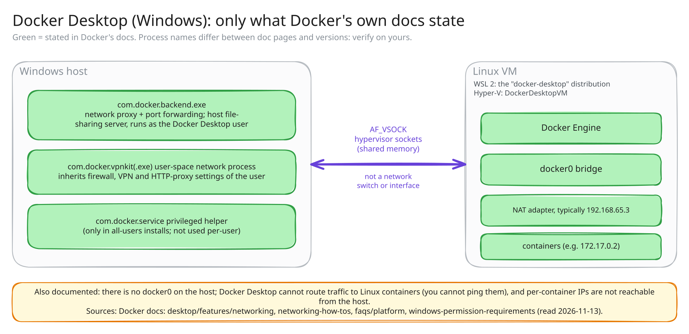

**How to read the diagram.** Everything in it is green because everything in it is stated in Docker's docs. The left box is the Windows host: `com.docker.backend.exe` (network proxy and port forwarding), `com.docker.vpnkit` (user-space network process, inherits the user's firewall/VPN/proxy settings) and the optional privileged `com.docker.service`. The right box is the Linux VM: the Docker Engine, the `docker0` bridge, the NAT adapter at `192.168.65.3`, and containers. The two sides talk over AF_VSOCK, drawn as a channel and *not* as a network. The note under the diagram lists the other documented facts.

> **What I removed.** The earlier version described a process tree, how packets are serialised into shared memory with write pointers and semaphores, a twelve-step "packet reconstruction" inside VPNKit, a `com.docker.dev-envs` process (Dev Environments was retired in Docker Desktop 4.42 and later), and a specific VM address (`172.20.144.5`). None of that is in the sources I could check, so it is removed rather than relabelled. VPNKit's own README says only that it "helps HyperKit VMs interoperate with host VPN configurations".

### 13.4 How traffic leaves, and how published ports come in

Both directions go through a **host-side process**. The VM is never directly addressable from outside.

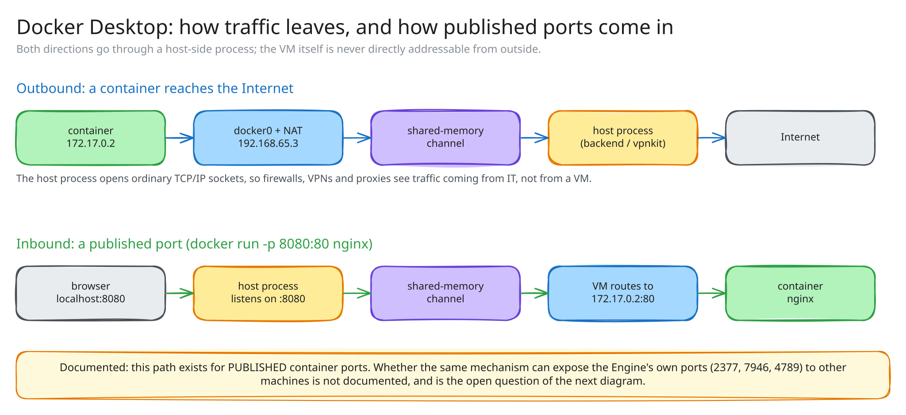

**How to read the diagram.**

- **Outbound (top):** a container (`172.17.0.2`) goes through `docker0` and NAT inside the VM, then the shared-memory channel, then a host process (backend/vpnkit), which opens **ordinary TCP/IP sockets on the host**. So firewalls, VPNs and proxies see the traffic coming from the host, not from a VM.
- **Inbound (bottom):** for `docker run -p 8080:80 nginx`, a browser connects to `localhost:8080`; the host process listening on `:8080` forwards through the channel; the VM routes to the container at `172.17.0.2:80`.
- **The footnote is the open question:** this path is documented for **published container ports**. Whether the same mechanism can expose the *Engine's own* ports (2377, 7946, 4789) to *other machines* is not documented.

#### Port forwarding in general

**Port forwarding** is a NAT technique that redirects traffic from an external IP:port to an internal IP:port (companion article, section 1). It suits client-server, request-response traffic: the client always initiates, the server answers, the NAT table tracks the connection, and each forwarded port goes to one internal endpoint. A forwarded port for a web server is the classic fit.

### 13.5 Primer: what is a proxy?

Docker Desktop's documentation describes its host process as a *proxy*. To follow the discussion we need the vocabulary. A **proxy** is an intermediary that handles a connection on someone's behalf: it ends the connection from one side and opens a new one on the other.

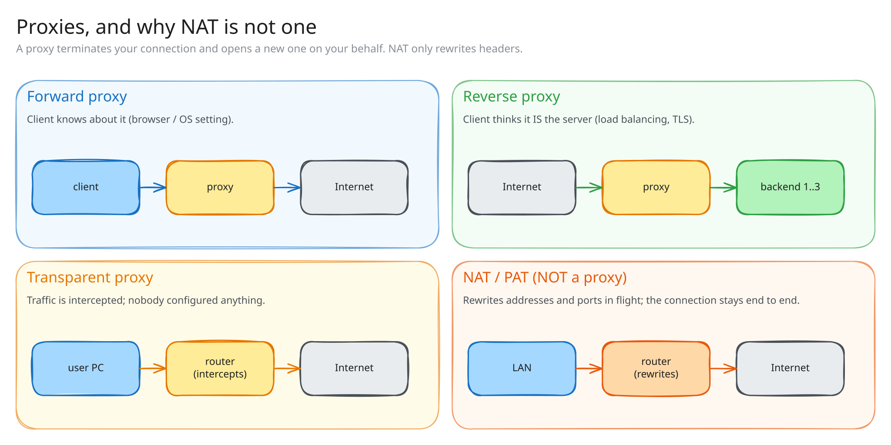

**How to read the diagram.**

| Kind | Who knows about it | Example | Typical use |
| --- | --- | --- | --- |
| **Forward proxy** | The *client* is configured to use it | Squid in a company | filtering, caching |
| **Reverse proxy** | The *client does not know*; it thinks the proxy is the server | nginx in front of app servers | load balancing, TLS |
| **Transparent proxy** | Nobody configured anything; traffic is intercepted | an ISP or firewall redirect (iptables REDIRECT) | filtering, monitoring |
| **NAT / PAT** | not a proxy | your home router | sharing one public IP |

**Why NAT is *not* a proxy:** a proxy terminates your connection and opens a new one. NAT only rewrites addresses and ports in flight; the connection stays end to end. (An earlier version of this article listed NAT as a type of proxy; that was a mistake.)

### 13.6 The open question: could a Docker Desktop VM be a swarm node?

What does a node need? From sections 4B and 5:

1. a **stable address** that every other node can reach,
2. the Engine's **own ports** (2377, 7946, 4789) reachable by other nodes, in both directions, and
3. **peer-to-peer** traffic (gossip and VXLAN, in both directions, starting from either side).

What the documentation tells us about Docker Desktop for each:

- **Address.** The VM has a private NAT address (`192.168.65.3` typically), and per-container IPs are not reachable from the host.
- **Ports.** Inbound traffic reaches the VM through a host-side process that forwards *published container ports*.
- **A Swarm *can* be active on Docker Desktop.** Docker's networking page tells you to leave any active Swarm before changing Desktop's internal IP ranges, which implies the combination exists.

What I could not find documented, and so mark as **hypotheses**:

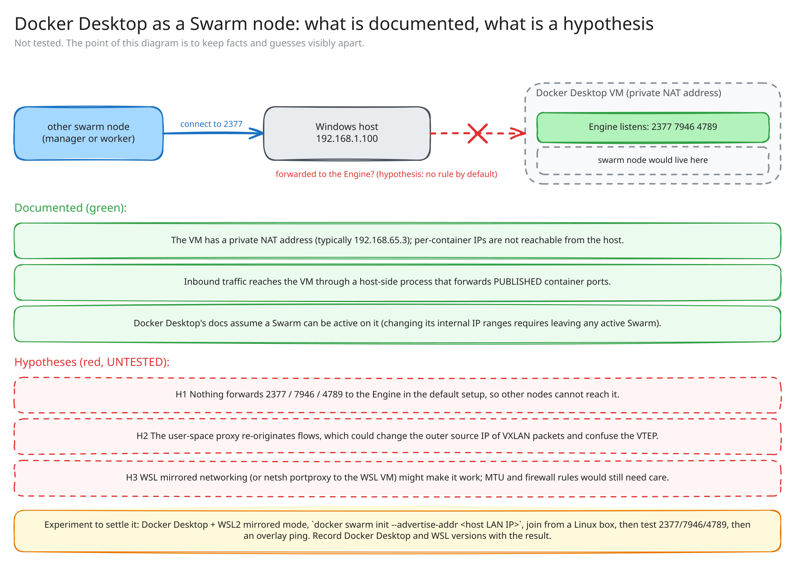

**How to read the diagram.** The picture shows another swarm node trying to connect to `2377` on a Docker Desktop VM behind the Windows host. The VM has a private NAT address; the question is whether the host forwards that connection to the Engine. The green box lists what is documented. The red box lists the three hypotheses:

- **H1: nothing forwards 2377 / 7946 / 4789 to the Engine in the default setup**, so other nodes cannot reach it.
- **H2: the user-space proxy re-originates connections**, so the *outer source address* of VXLAN packets could change. Reasoning (inferred): a VTEP identifies its peers by IP address; if the packets arrive from the Windows host's address instead of the VM's, the receiver's tables, which came from gossip, might not match them.
- **H3: WSL mirrored networking, or `netsh interface portproxy` to the WSL VM, might make it work.** MTU and firewall rules would still need care.

> **The experiment that would settle it:** Docker Desktop with WSL 2 in mirrored mode, `docker swarm init --advertise-addr <host LAN IP>`, join from a Linux machine, test `2377`, `7946` and `4789`, then ping across an overlay network. Record the Docker Desktop and WSL versions with the result.

### 13.7 Why this guide does not put Tailscale inside Docker Desktop's own distribution

An obvious idea: install Tailscale inside Docker Desktop's VM so that its Engine gets a Tailscale address. This guide does not do that.

What is documented: Docker Desktop manages the `docker-desktop` distribution itself, and running a second Engine alongside it can cause conflicts. This guide sidesteps the question by using a **separate Ubuntu distribution**, where Docker Engine and Tailscale are both normal installations and share the same network namespace.

Whether Tailscale could run inside the `docker-desktop` distribution is **untested**. The earlier version of this article asserted four reasons it could not (a read-only root filesystem, no systemd, network restrictions, the VM being replaced on update) and showed `mount` and `ps` output for them. I could not verify any of those, and the output was not captured from a real machine, so I have removed them. If you want to document this, capture it yourself:

> **Observed on:** Docker Desktop ______ / WSL ______ / Windows ______ (date ______)
>
> ```powershell
> wsl --version
> wsl -d docker-desktop -- sh -c 'uname -a; mount | head -3; ps | head -5'
> ```
>
> Result: ______

### 13.8 Conclusion

- **Documented:** Docker Desktop reaches the outside through a host-side process; containers are not directly addressable; published container ports are forwarded in through that process.
- **Not documented:** whether Docker Desktop can expose the Engine's own swarm ports to other machines, and how its proxy treats VXLAN. The earlier claim that it is *architecturally impossible* is therefore a **hypothesis**.
- **A safer, testable path** (and what this guide uses): a normal WSL 2 distribution with its own Docker Engine and Tailscale, which gives the Engine a stable, reachable `100.x.y.z` address and lets VXLAN ride inside Tailscale's tunnel.
- Docker Desktop remains excellent for local development. For a swarm, prefer **Linux servers**, **cloud VMs**, or **Docker Engine inside WSL 2 with Tailscale**.

---
## 14. The solution: Docker Swarm over Tailscale

We now know what Swarm needs and what gets in the way. The solution is to sidestep Docker Desktop and give each machine two things that live in the **same Linux network namespace**:

1. **Docker Engine**, running directly in a normal WSL 2 Ubuntu distribution (not the `docker-desktop` one).
2. **Tailscale**, running in that same Ubuntu, creating a real `tailscale0` interface there.

With both in one namespace, `docker swarm init --advertise-addr $(tailscale ip -4)` can work: Docker binds to the Tailscale address, the overlay's VXLAN packets leave through `tailscale0` and are encrypted by WireGuard, and gossip reaches every node.

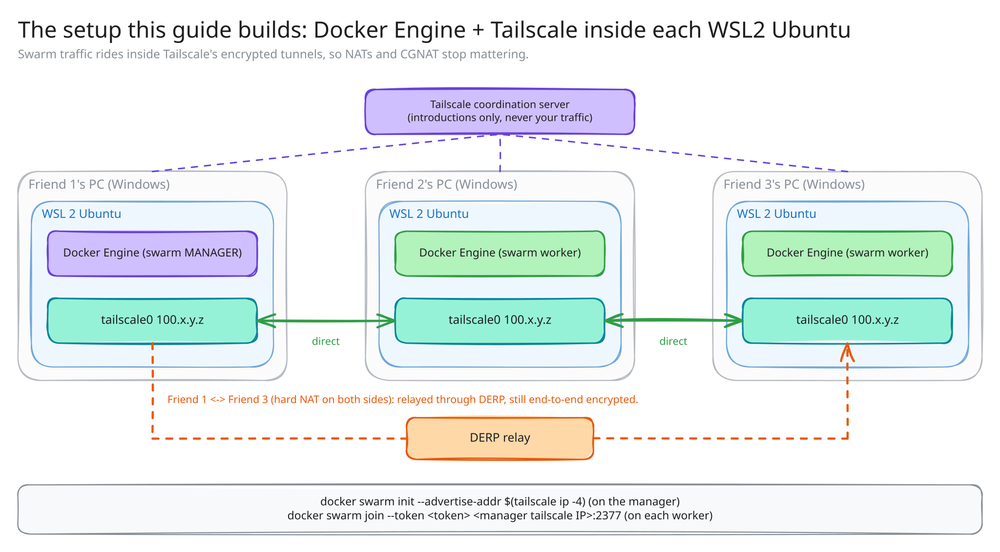

**How to read the diagram.** Three friends' PCs, each running Windows with a WSL 2 Ubuntu. Inside each Ubuntu, Docker Engine (one swarm **manager**, two **workers**) and `tailscaled` with its `tailscale0 100.x.y.z` interface. Solid lines between PCs are Tailscale tunnels: two are **direct**. Friends 1 and 3 have hard NAT on both sides, so their traffic is **relayed through a DERP server**, still end-to-end encrypted. The coordination server at the top only makes introductions and never sees traffic. The two commands at the bottom are the whole Swarm setup: `docker swarm init --advertise-addr $(tailscale ip -4)` on the manager and `docker swarm join ...` on each worker.

**The encapsulation stack** (the same idea twice: the companion article's section 2, and section 8 here):

```text
App data
  v  Container IP packet:    [IP 10.0.1.5 -> 10.0.1.7][TCP/UDP][data]
  v  VXLAN encapsulation:    [Eth][IP][UDP :4789][VXLAN header][container frame]   (adds 50 bytes)
  v  tailscale0 / WireGuard: [UDP :41641][WireGuard-encrypted payload]            (userspace wireguard-go)
  v  Windows NAT:            [public IP][WireGuard packet] -> Internet
```

A NAT or firewall on the path only ever sees the outermost encrypted UDP packet (or, via a relay, ordinary HTTPS). Everything inside, VXLAN headers, container IPs and app data, is encrypted and opaque. **That is why NAT does not break the cluster.**

The path through the steps, each with a check:

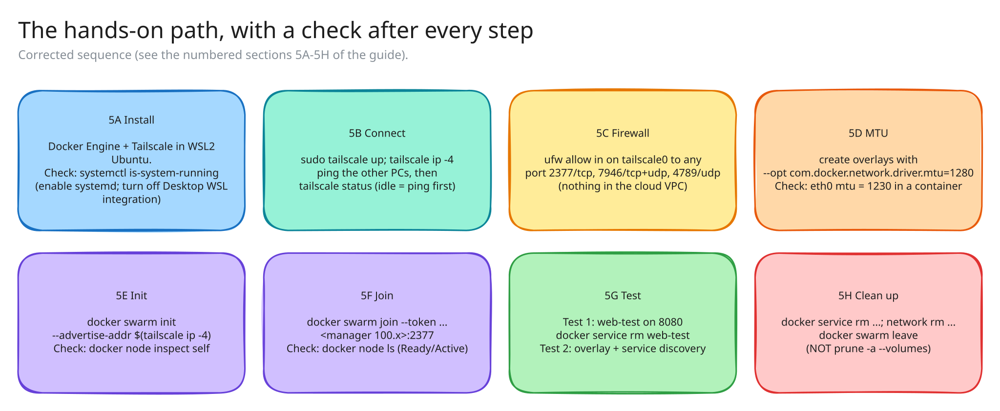

**How to read the diagram.** Eight boxes, left to right and top to bottom, are sections 14A to 14H. Each lists the action and the **check** that tells you it worked before you continue. The corrected order matters: firewall before init, MTU option *before* the first overlay is created, and cleanup that does not run `prune -a --volumes`.

---

### 14A. Prerequisites: install Docker Engine and Tailscale

Run on **every machine** that will join the swarm.

**Step 0: enable systemd in your WSL Ubuntu** (skip on a plain Linux machine). `systemctl enable docker` and `tailscaled` both need it. It is on by default only for the current Ubuntu from `wsl --install`. Otherwise:

```bash
sudo tee /etc/wsl.conf > /dev/null <<'EOF'
[boot]
systemd=true
EOF
```

Then, from Windows PowerShell: `wsl --shutdown`, reopen Ubuntu, and check:

```bash
systemctl is-system-running      # expect: running (or degraded)
ls /dev/net/tun                  # Tailscale needs the TUN device; expect the file to exist
```

(Needs WSL 0.67.6 or newer; check with `wsl --version`.)

**If Docker Desktop is also installed on this PC:** open Docker Desktop, *Settings, Resources, WSL integration*, and **turn integration off for this Ubuntu distribution**. Docker's documentation warns that running a separate Engine inside a distribution that Desktop also integrates with can cause conflicts.

#### Install Docker Engine

> **Do not use Docker Desktop for this.** Install Docker Engine directly into WSL 2 Ubuntu (or your Linux machine).

```bash
# Remove any old installations
sudo apt remove docker docker-engine docker.io containerd runc

# Dependencies
sudo apt update
sudo apt install -y ca-certificates curl gnupg lsb-release

# Docker's official GPG key
sudo mkdir -p /etc/apt/keyrings
curl -fsSL https://download.docker.com/linux/ubuntu/gpg \
  | sudo gpg --dearmor -o /etc/apt/keyrings/docker.gpg

# The repository
echo \
  "deb [arch=$(dpkg --print-architecture) signed-by=/etc/apt/keyrings/docker.gpg] \
  https://download.docker.com/linux/ubuntu $(lsb_release -cs) stable" \
  | sudo tee /etc/apt/sources.list.d/docker.list > /dev/null

# Install
sudo apt update
sudo apt install -y docker-ce docker-ce-cli containerd.io docker-buildx-plugin docker-compose-plugin

# Start now and at every boot (needs systemd, see Step 0)
sudo systemctl enable --now docker

# Allow your user to run docker without sudo
sudo usermod -aG docker $USER
newgrp docker
```

Verify:

```bash
docker --version
docker ps          # an empty list and no errors
```

#### Install Tailscale

```bash
curl -fsSL https://tailscale.com/install.sh | sh
sudo systemctl enable --now tailscaled
sudo tailscale up
# Open the authentication URL it prints
```

Your Tailscale address, which everything else will use:

```bash
tailscale ip -4
# e.g. 100.101.102.103
```

---

### 14B. Check that the machines can reach each other

Before touching Swarm, confirm the machines reach each other through Tailscale, from both sides.

```bash
ping -c 4 <OTHER_MACHINE_TAILSCALE_IP>
tailscale status
```

`tailscale status` prints one line per peer. The end of each line shows how you are connected:

```text
100.101.102.104  machine-b  ...  active; direct 203.0.113.7:41641     # direct peer-to-peer (ideal)
100.101.102.105  machine-c  ...  active; relay "fra"                  # via a DERP relay in region "fra"
100.101.102.106  machine-d  ...  idle                                 # nothing flowing right now
```

(The wording is from Tailscale's source; the addresses here are examples. `idle` means no traffic yet: ping, then run `status` again.) To watch the path decision happen, run `tailscale ping 100.x.y.z`; it reports whether each reply came through a relay or directly. Direct is faster, but **relayed connections work for Swarm**. Tailscale handles NAT traversal automatically.

---

### 14C. Open the required ports (in the right place)

| Port | Protocol | Purpose |
| --- | --- | --- |
| 2377 | TCP | Control plane and Raft (manager listens; workers and other managers connect) |
| 7946 | TCP + UDP | Gossip (all nodes, both directions) |
| 4789 | UDP | VXLAN overlay traffic |

**Where a firewall can see which packets.** This is the part people get wrong.

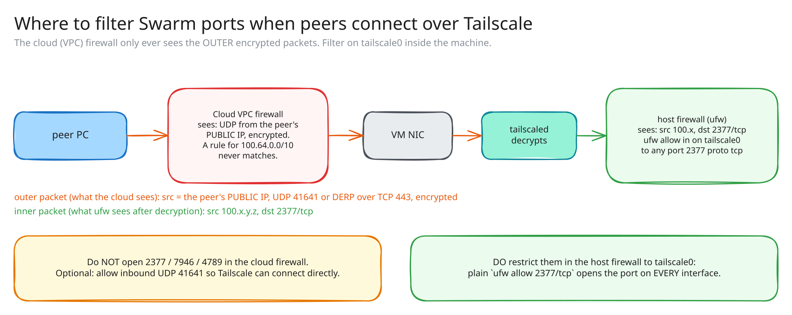

**How to read the diagram.** A peer PC sends Swarm traffic to your machine. On the way in, the packet passes two filters:

- **The cloud (VPC) firewall**, in front of a cloud VM, sees the **outer** packet: UDP (typically port 41641) from the peer's *public* IP, or DERP over TCP 443, all encrypted. A rule for `100.64.0.0/10` **never matches**, because no `100.x` source address exists on the outside.
- **The host firewall (ufw)** inside the machine sees the **inner** packet after `tailscaled` has decrypted it: source `100.x.y.z`, destination `2377/tcp`. That is where a `100.x` rule belongs.

So: **do not** open 2377, 7946 or 4789 in the cloud firewall. Optionally allow inbound UDP 41641 so Tailscale can connect directly. **Do** restrict the swarm ports in the host firewall to the `tailscale0` interface. A plain `ufw allow 2377/tcp` opens the port on **every** interface, including the public one.

#### Linux or WSL with UFW

```bash
sudo ufw allow in on tailscale0 to any port 2377 proto tcp
sudo ufw allow in on tailscale0 to any port 7946 proto tcp
sudo ufw allow in on tailscale0 to any port 7946 proto udp
sudo ufw allow in on tailscale0 to any port 4789 proto udp
```

> Before running `sudo ufw enable` on a remote machine, allow SSH first (for example `sudo ufw allow OpenSSH`), or you can lock yourself out. UFW does nothing while it is inactive.
>
> Docker's own documentation notes that ports *published* by containers are handled by Docker's iptables rules and can bypass UFW. Treat UFW as protection for the swarm ports above, and decide deliberately which published ports you expose.

#### Cloud VMs (GCP, AWS and so on)

Do **not** create a rule for `100.64.0.0/10` for these ports; it would match nothing. Leave the swarm ports closed in the VPC firewall. Everything travels inside Tailscale's tunnel, which only needs outbound access (and optionally inbound UDP 41641).

---

### 14D. MTU: make the overlay fit the tunnel

The **MTU (Maximum Transmission Unit)** is the largest packet an interface sends in one piece. Ethernet's is 1500 bytes. Every wrapper (VXLAN, WireGuard) takes some of that room, so the packet *inside* must be smaller or it will be fragmented or dropped.

Tailscale sets `tailscale0` to **1280 bytes**. Verify:

```bash
ip link show tailscale0 | grep mtu
# expect: ... mtu 1280 ...
```

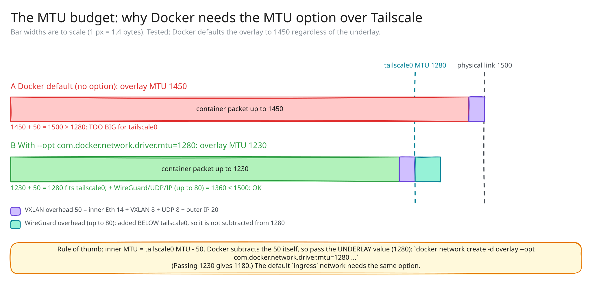

**How to read the diagram.** Bars are drawn to scale. The thin bars at the top are the two limits: `tailscale0` at 1280 and the physical link at 1500.

- **Row A, Docker's default:** the overlay MTU is **1450** (1500 minus 50). Add the 50 bytes of VXLAN and the packet is 1500, which is **too big for `tailscale0`** (1280).
- **Row B, with the option:** the overlay MTU is **1230**. Add the 50 VXLAN bytes and you get **1280**, which fits `tailscale0`. Below `tailscale0`, WireGuard, UDP and IP add up to 80 more bytes, giving 1360, which is under the physical 1500. OK.
- **Rule of thumb:** inner MTU = `tailscale0` MTU − 50. The WireGuard overhead is added *below* `tailscale0`, so it is **not** subtracted from 1280 again.

> **Observed on Docker 29.9.2:** with an underlay interface of MTU 1280 holding the advertised address, a container on a default overlay still had `eth0` MTU **1450**. Docker does not adapt to the underlay. So the kernel does **not** "handle the math", and earlier versions of this article were wrong to say so (they also subtracted 60 for WireGuard from 1280, which gave a wrong figure of about 1170).

**The fix** (Docker subtracts the 50 itself, so pass the *underlay* value, 1280, not 1230):

```bash
docker network create -d overlay --attachable \
  --opt com.docker.network.driver.mtu=1280 \
  app-network
```

Observed: this gave `eth0` MTU **1230** in the container. (Passing `1230` gave 1180.) Create every overlay network you use this way.

**The default `ingress` network needs the same option**, because the routing mesh uses it. Docker documents recreating it with `--ingress` while no service uses it:

```bash
docker network rm ingress          # only when no service publishes ports
docker network create -d overlay --ingress \
  --opt com.docker.network.driver.mtu=1280 ingress
```

> I tested the `--opt` on user-defined overlays only. Recreating `ingress` follows Docker's documented procedure but was not run here. Do it before you deploy services that publish ports.

**Checks.**

1. On each host, the tunnel itself (`1280 - 28 = 1252` bytes of payload; `-M do` forbids fragmentation):

   ```bash
   ping -M do -s 1252 -c 4 <OTHER_MACHINE_TAILSCALE_IP>   # all 4 should succeed
   ping -M do -s 1400 -c 2 <OTHER_MACHINE_TAILSCALE_IP>   # should fail: "Message too long"
   ```

2. **Across the overlay** (this is the one that tests your Docker setting; the host ping above does not): inside a container, `cat /sys/class/net/eth0/mtu` should print `1230`. Then, between two containers on *different* nodes, `1230 - 28 = 1202`:

   ```bash
   ping -M do -s 1202 -c 3 <OTHER_CONTAINER_OVERLAY_IP>   # should succeed
   ping -M do -s 1203 -c 3 <OTHER_CONTAINER_OVERLAY_IP>   # should fail
   ```

---

### 14E. Initialise the swarm

Choose one machine as the **manager**:

```bash
MANAGER_IP=$(tailscale ip -4)
echo "Manager Tailscale IP: $MANAGER_IP"
docker swarm init --advertise-addr $MANAGER_IP
```

Output, abbreviated:

```text
Swarm initialized: current node (abc123def456) is now a manager.
To add a worker to this swarm, run the following command:
    docker swarm join --token SWMTKN-1-xxxxxxxx 100.101.102.103:2377
```

Copy the whole `docker swarm join` line. Confirm what address Swarm advertised: it must be the Tailscale address, not a WSL or Docker Desktop address:

```bash
docker node inspect self --format '{{ .Status.Addr }}'
# expect: 100.101.102.103   (your Tailscale IP)
```

---

### 14F. Join the workers

On each other machine, paste the join command:

```bash
docker swarm join --token SWMTKN-1-xxxxxxxx 100.101.102.103:2377
# expect: This node joined a swarm as a worker.
```

On the manager:

```bash
docker node ls
```

```text
ID                  HOSTNAME   STATUS   AVAILABILITY   MANAGER STATUS
abc123def456 *      machine-a  Ready    Active         Leader
xyz789ghi012        machine-b  Ready    Active
```

Both `Ready` and `Active`: the cluster is live. (`*` marks the node you are on.)

---

### 14G. Deploy and verify

#### Test 1: a service spread across nodes (the routing mesh)

```bash
docker service create --name web-test --replicas 4 \
  --publish published=8080,target=80 nginx:alpine
docker service ps web-test
```

```text
NAME         IMAGE         NODE        DESIRED STATE   CURRENT STATE
web-test.1   nginx:alpine  machine-a   Running         Running
web-test.2   nginx:alpine  machine-b   Running         Running
web-test.3   nginx:alpine  machine-a   Running         Running
web-test.4   nginx:alpine  machine-b   Running         Running
```

Containers are spread over both nodes. Because of the routing mesh (diagram in 5.5), `curl http://localhost:8080` works on **either** machine and reaches any replica, even one on the other node:

```bash
curl -s http://localhost:8080 | grep -o "Welcome to nginx"
```

**Now remove it before Test 2.** Published ports are claimed cluster-wide, so the next test, which also publishes `8080`, would be refused with "port '8080' is already in use by service 'web-test'" (observed):

```bash
docker service rm web-test
```

(Or publish `8081` in Test 2 instead.)

#### Test 2: overlay network and service discovery across nodes

This confirms that containers on different nodes find and reach each other **by name** through the overlay: the feature that makes Swarm useful.

```bash
# Use the network you created with the MTU option in 14D
docker service create --name redis --network app-network \
  --constraint 'node.hostname==machine-b' redis:alpine

docker service create --name webapp --replicas 3 --network app-network \
  --publish published=8080,target=80 nginx:alpine
```

The `--constraint` pins Redis to one node, so that at least one `webapp` replica, on the other node, must cross the VXLAN tunnel. (Remember from section 11: two containers on the *same* node never use VXLAN, so a test where everything lands on one node proves nothing about the tunnel.) Check where things landed with `docker service ps webapp redis`.

Then, from a `webapp` replica **on a different node than Redis**:

```bash
CONTAINER_ID=$(docker ps --filter "name=webapp" -q | head -1)
docker exec -it $CONTAINER_ID sh
# inside the container:
apk add redis
redis-cli -h redis ping
# PONG
```

`PONG` confirms that the container resolved the name `redis` through Docker's overlay DNS, reached the Redis container across the Tailscale tunnel (VXLAN inside WireGuard), and got a reply.

---

### 14H. Clean up

```bash
# Remove services and the custom network
docker service rm webapp redis
docker network rm app-network

# On worker machines: leave the swarm
docker swarm leave

# On the manager: remove the departed nodes, then dismantle the swarm
docker node rm <WORKER_NODE_ID>
docker swarm leave --force
```

> **Do not run `docker system prune -a --volumes -f` on a friend's machine as a cleanup.** It deletes **all** unused images and **all** unused volumes on that Docker Engine, including data volumes from unrelated projects. If you want to reclaim space, run `docker image prune` or `docker volume ls` first and decide what to remove.

---

## 15. Where to go next

- **Verify it, don't trust it.** The facts marked *observed* come from a single-node swarm on Docker 29.9.2. A multi-node test over a real Tailscale network, with captured FDB entries, packet captures and MTU pings, would turn the *not verified* items into verified ones.
- **Settle the Docker Desktop question** with the experiment in 13.6 and record the versions.
- **Harden it:** use ACLs in Tailscale to allow only the swarm ports between swarm nodes; use an odd number of managers (3 or 5); and restrict which published ports you expose.

---

## Glossary

| Term | One-line meaning | First used |
| --- | --- | --- |
| Packet | A small chunk of data with an addressing header | 4B |
| IP address / port / socket | Names a machine / a program on it / the pair | 4C |
| Router, hop, gateway | A device joining networks / one handover / the exit router | 4B, 4D |
| Routable | A packet addressed to it can be delivered from where you are | 4B |
| NAT, CGNAT | Router rewrites addresses to share one public IP / the ISP does it too | 4E, deep dive 1 |
| Firewall | Software that allows or blocks traffic by rule | deep dive 2 |
| VPN, tunnel | An encrypted link across the Internet / one packet wrapped in another | deep dive 2 |
| WireGuard | The encrypted-tunnel protocol Tailscale uses | deep dive 3 |
| TUN device | A virtual network interface that hands IP packets to a program (`tailscale0`) | deep dive 4 |
| Kernel, daemon | The core of the OS / a background program (`dockerd`, `tailscaled`) | 6.1, 6.2 |
| VM, hypervisor | A software-simulated computer / what runs VMs | 6.1 |
| Container, namespace, cgroup | A process with a restricted view / the view / the resource budget | 6.1, 6.2 |
| veth, bridge | A virtual cable / a virtual switch | 6.3 |
| Node, manager, worker, service, task | Swarm vocabulary | 4A |
| Raft, quorum | Managers' agreement algorithm / a majority | 5.3 |
| Gossip | Spreading news by telling random peers | 5.2 |
| Overlay / underlay | The virtual network / the real network below it | 6.5 |
| VXLAN, VNI, VTEP | Ethernet-in-UDP tunnel / network ID / its endpoint | 8 |
| FDB, ARP | Table of which host owns which MAC / asking "who has this IP?" | 9.2, 4D |
| MTU | Largest packet an interface sends in one piece | 14D |
| WSL 2, systemd | Linux in a Windows VM / the service manager | 13.2, 14A |

---

## Change notes

What this draft changes compared with the original, in one place:

- **Structure.** A "Swarm in 90 seconds" primer (4A) and a glossary were added; the Swarm ports section now warns about its forward references; the repeated explanations of IPv4 exhaustion, RFC 1918, CIDR and the traceroute exercise were merged; the chat-preamble leftovers were removed; titles were unified; the two articles now link to each other.
- **Diagrams.** All 41 diagrams are placed with a "how to read the diagram" walkthrough. 26 replace existing ASCII or Mermaid visuals, 15 are new.
- **Corrections (verified on Docker 29.9.2, or from upstream source):** same-host containers can talk (6.3); the VXLAN device is `vxlan0` inside a per-network namespace and has no `nolearning` flag (9.1); VNIs are 4096, 4097, 4098 (7.1, 8.2); the overlay MTU does not adapt and the correct inner MTU is 1230 (14D); Raft timing is about 10 s (5.3); Test 2 needed `web-test` removed first (14G); cloud firewalls cannot match `100.x` sources (14C); Tailscale's WireGuard is userspace on a kernel TUN device, and connections start on DERP and upgrade (deep dive 3, 4); systemd and Docker Desktop's WSL integration need explicit steps (14A); `prune -a --volumes` is no longer recommended (14H).
- **Docker Desktop.** Reduced to what Docker documents, with the Swarm-node verdict stated as a hypothesis and an experiment to settle it (13). The invented process tree, packet-reconstruction steps, memory-pointer details and unverified `docker-desktop` filesystem claims were removed.
- **Still not verified:** multi-node behaviour (real FDB entries, gossip timing), Windows and Docker Desktop internals, and a full Tailscale-on-WSL2 run.

[Companion: NAT and Tailscale from First Principles](tailscale-nat-deep-dive.md)
