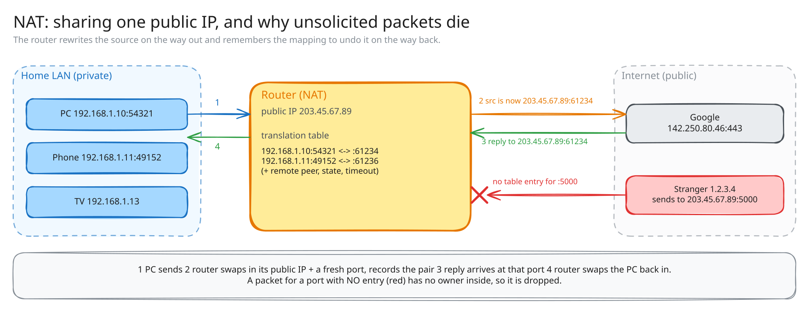
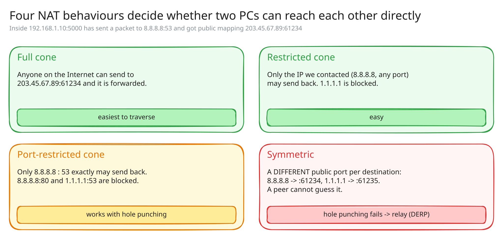
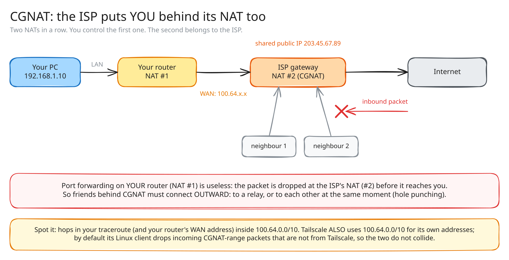
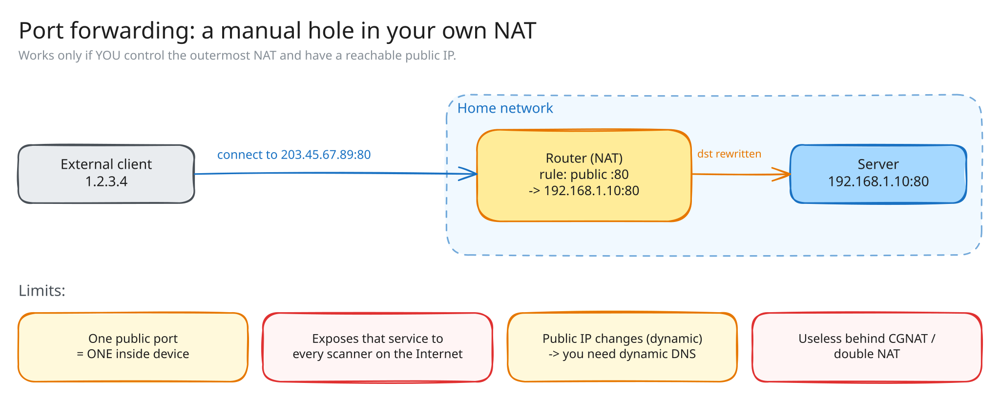
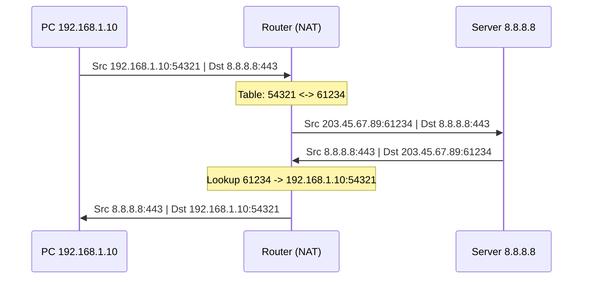
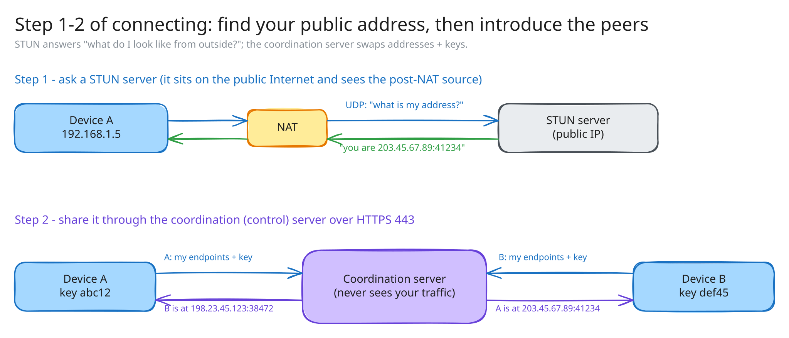
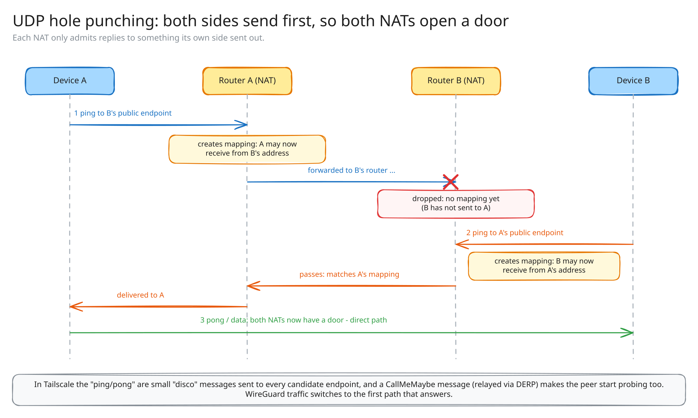
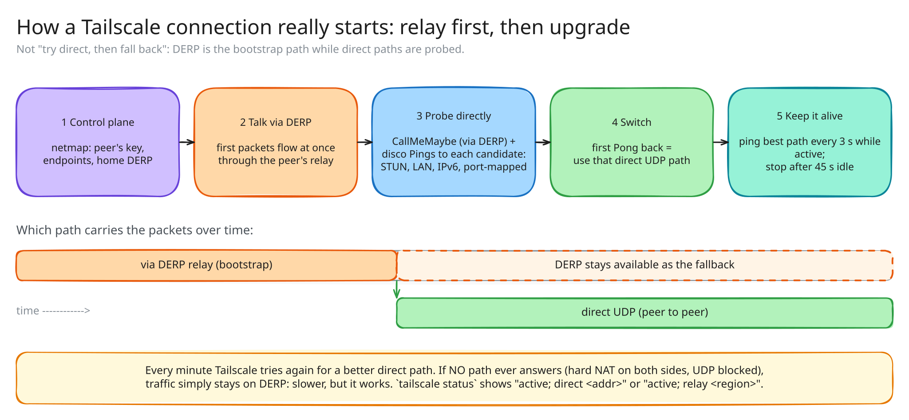
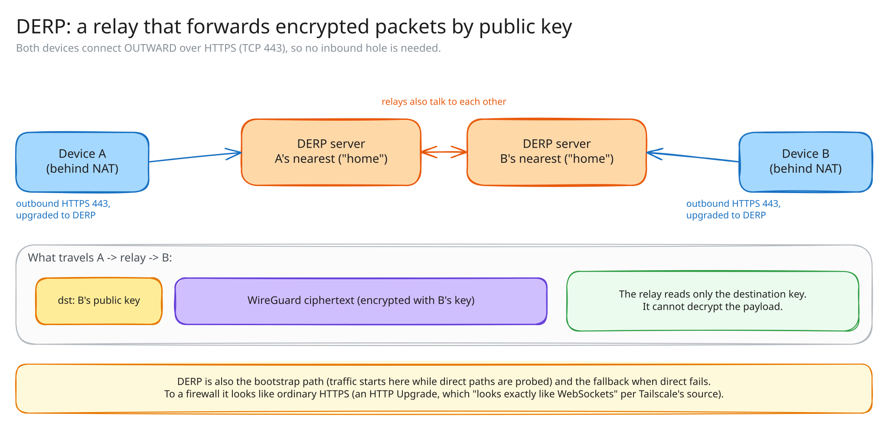
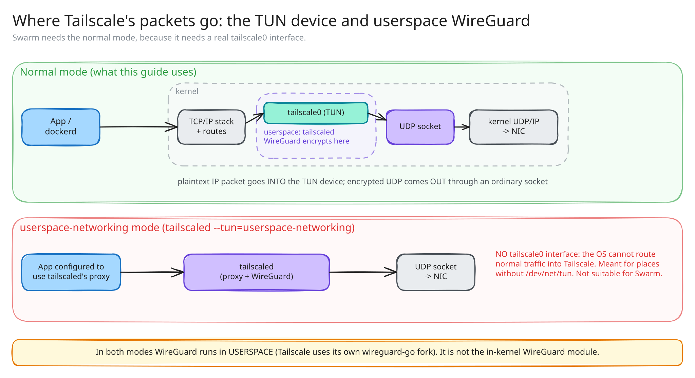

# NAT and Tailscale, from First Principles

> **Draft v2** of the companion article. Same flow as the original, rebuilt around the diagrams in [`../diagrams/`](../diagrams). Facts follow the corrected review: Tailscale behaviour is taken from its open-source client, Docker behaviour from runs on Docker 29.9.2. Where something is inferred and not documented, the text says so.
>
> Part of a two-article set. The story and the hands-on setup are in [Running Docker Swarm Across Friends' PCs with Tailscale](swarm-across-friends-pcs-with-tailscale.md). This article is the reference for *why friends' PCs cannot reach each other, and how Tailscale makes them reachable*.

**You need no networking background.** Every term is defined where it first appears. If you already know what an IP address, a port and a router are, you can skim section 1.

**What you will be able to explain at the end**

1. Why your friend's PC cannot simply connect to yours.
2. What NAT does to every packet, and why it drops unsolicited ones.
3. Why port forwarding fails behind CGNAT.
4. How Tailscale gets two NATed PCs talking directly, and what it does when that fails.
5. What the `tailscale0` device is, and why `100.64.0.0/10` matters.

---

## 1. What is NAT (Network Address Translation)?

### The basic definition

**NAT is something a router does: it rewrites the IP address and port numbers inside packet headers as traffic passes between two networks.**

A *packet* is one small chunk of data with a header on the front saying where it came from and where it is going. An *IP address* names a machine (`192.168.1.10`). A *port* names a program on that machine (`443` is the web). A router joins two networks and forwards packets between them. NAT translates between:

- **Private addresses**, used inside your home: `192.168.x.x`, `10.x.x.x`, `172.16-31.x.x`.
- **Public addresses**, used on the Internet.

### Why NAT exists

IPv4 addresses are 32 bits long, so there are only 2³² ≈ 4.3 billion of them, fewer than there are connected devices. The permanent fix is **IPv6** (128-bit addresses), but IPv4 is still carried by almost every home network. The stop-gap that kept IPv4 alive is NAT: many devices share one public address.

The ranges reserved for private use (RFC 1918) are:

```
10.0.0.0     - 10.255.255.255   (16,777,216 addresses)
172.16.0.0   - 172.31.255.255   (1,048,576 addresses)
192.168.0.0  - 192.168.255.255  (65,536 addresses)
```

Any home can reuse these. Internet routers drop packets that carry them, so a private address can only be reached from *inside* its own network. Keep that sentence in mind; the rest of this article is about getting around it.

> **"Routable" in this article** means: a packet addressed to it can be delivered from where the sender sits. `192.168.1.10` is routable from your own LAN and not routable from your friend's house.

### What NAT does to packets

#### Outbound (private to public)

Your PC `192.168.1.10` opens a connection to Google. Its packet leaves with source `192.168.1.10:54321` and destination `142.250.80.46:443`. The router changes it before forwarding:

| Where | Source | Destination | What happened |
| :--- | :--- | :--- | :--- |
| Inside your LAN | `192.168.1.10:54321` | `142.250.80.46:443` | PC sends to its gateway (the router) |
| After the router | `203.45.67.89:61234` | `142.250.80.46:443` | Router swapped in its public IP and a fresh port |

The router performs five operations: replace the source IP, replace the source port with an unused one, record the pair in its **translation table**, recompute the IP and TCP/UDP checksums, forward.

#### The translation table

| Inside address:port | Public port | Remote | Proto | State | Typical timeout |
| --- | --- | --- | --- | --- | --- |
| 192.168.1.10:54321 | 61234 | 142.250.80.46:443 | TCP | ESTAB | hours |
| 192.168.1.10:54322 | 61235 | 140.82.121.4:443 | TCP | ESTAB | hours |
| 192.168.1.11:49152 | 61236 | 8.8.8.8:53 | UDP | active | seconds to minutes |

An entry is created by an **outbound** packet, refreshed by traffic, and removed after a timeout with no traffic. Exact timeouts vary by router; UDP entries are the short-lived ones, and that matters when we reach Tailscale's keep-alives.

#### Inbound (the reply)

Google answers to `203.45.67.89:61234`. The router looks up port `61234`, finds `192.168.1.10:54321`, rewrites the *destination* back, fixes checksums and forwards it inside.



**How to read the diagram**

1. The PC sends from `192.168.1.10:54321`.
2. The router writes its public IP and a fresh port (`61234`) into the source and stores the pair in the table (4).
3. The reply comes back to `:61234`.
4. The table maps it back to the PC.
5. The red packet at the bottom is the key to everything that follows: a stranger sends to port `5000`, there is no table entry, so the router has no inside owner to give it to. It drops the packet.

### Types of NAT behaviour

Routers differ in *who is allowed to send back through a mapping*. Take a PC at `192.168.1.10:5000` that has sent one packet to `8.8.8.8:53` and got the public mapping `203.45.67.89:61234`.



| Type | Who may send back to `203.45.67.89:61234` | Effect on direct connections |
| --- | --- | --- |
| **Full cone** | Anyone | Easiest |
| **Restricted cone** | Only `8.8.8.8` (any port) | Easy once we have sent to the peer's IP |
| **Port-restricted cone** | Only `8.8.8.8:53` exactly | Works if both sides send first (see hole punching) |
| **Symmetric** | Only `8.8.8.8:53`, and talking to `1.1.1.1` gets a *different* public port (`61235`) | The peer cannot guess our port, so hole punching usually fails and a relay is needed |

The first three are called **cone** NATs: one inside socket keeps one public port whoever it talks to. **Symmetric** NAT gives each (inside socket, destination) pair its own public port.

### The unsolicited inbound packet

What happens when `1.2.3.4` sends to `203.45.67.89:5000` with no prior conversation:

1. The packet reaches the router's public side.
2. The router searches its table for public port `5000`.
3. Nothing is found.
4. The packet is dropped.

Even if only one device lives inside, the router will not guess. This is a side effect of how translation works, not a designed-in security feature (see "What NAT does not do" below).

### Connection state, briefly

NAT tracks conversations at the transport layer (layer 4 of the 7-layer model, the layer that holds ports).

- **TCP** has a handshake (SYN, SYN-ACK, ACK). The router moves an entry from `SYN_SENT` to `ESTABLISHED` as it sees the handshake, and deletes it on FIN or after a long idle timeout.
- **UDP** has no handshake and no connection. The router pretends there is one: an outbound packet creates a mapping with a short timer, a matching inbound packet is allowed and refreshes the timer, silence lets it expire.

Hold on to the UDP behaviour. Hole punching works *because* UDP mappings are this simple.

### CGNAT: when your ISP puts you behind its NAT as well

IPv4 shortage reached the ISPs too. Many now do not give your router a public address at all. They give it a private one from `100.64.0.0/10`, a range reserved for exactly this, and share one public address across many customers. This is **Carrier-Grade NAT (CGNAT)**, and it creates **double NAT**:

1. **NAT #1, your router:** `192.168.1.x` becomes `100.64.x.x`.
2. **NAT #2, the ISP gateway:** `100.64.x.x` becomes a shared public address.



**How to read the diagram.** An inbound packet is dropped at NAT #2, in the ISP's equipment, which you do not control. Nothing you configure on NAT #1 can change that. So anyone behind CGNAT must connect *outward*: to a relay, or to a peer at the same moment (hole punching).

**Check whether you are behind CGNAT.** Run `traceroute 8.8.8.8` (Windows: `tracert`) and look at the first few hops. A hop inside `100.64.0.0/10` (that is `100.64.0.0` to `100.127.255.255`) is your ISP's NAT. Also compare your router's WAN address with what a "what is my IP" site reports: if they differ, there is NAT beyond your router.

**A collision worth knowing about.** Tailscale also hands out addresses from `100.64.0.0/10`. On Linux, Tailscale's firewall rules by default drop packets in that range that do not arrive through `tailscale0`, so ISP-side CGNAT traffic and Tailscale traffic do not get confused. You will see this range twice in this series and now you know why.

### What NAT does not do

- **It is not a firewall.** Dropping unsolicited packets is a *side effect* of having no table entry. Internal devices can still be attacked through connections they open themselves, and a router that also runs a stateful firewall is doing two jobs.
- **It does not allow inbound connections by default.** You need a manual rule (port forwarding, UPnP) or a traversal technique (STUN, hole punching, relays).
- **It breaks protocols that put addresses inside the payload** (FTP, SIP). The router needs an Application Layer Gateway to rewrite them.
- **It hides your topology only partly.** Outsiders see one public IP, not how many devices share it.

### Port forwarding: a manual hole in your own NAT

A **port forwarding rule** tells the router: "anything arriving on public port 80 goes to `192.168.1.10:80`." The router checks its *static* table, rewrites the destination, fixes checksums and forwards.



**The four limits shown under the diagram**

- **One public port maps to one inside device.** Two web servers cannot both take port 80.
- **Exposure.** The service is open to every scanner on the Internet.
- **Dynamic public IP.** Your ISP can change the address, so you need Dynamic DNS to keep a name pointing at it.
- **CGNAT / double NAT.** The packet dies at the ISP's NAT; your rule is never consulted.

Because of the last limit, port forwarding cannot be the foundation for a cluster built from *friends'* PCs.

### Visual summary: the two flows as a sequence

Outbound request and inbound reply, written as the packet headers at each point.



---

## 2. VPNs and stateful firewalls

A **VPN (Virtual Private Network)** builds an encrypted *tunnel* across an untrusted network such as the Internet, so that machines far apart can talk as if they were on one local network. A **tunnel** is simply one packet wrapped inside another. The inner packet is the one the applications care about; the outer packet is what the Internet carries. You will meet this idea again with WireGuard here and VXLAN in the main article.

A **firewall** filters traffic by rules. A **stateful** firewall remembers conversations: it allows replies to traffic that left from inside and blocks unsolicited traffic that arrives from outside. That is exactly the behaviour NAT gave us, and exactly the obstacle for peer-to-peer connections.

How VPNs get through: the client makes an **outbound** connection to a server on the public Internet. Because it started from inside, the NAT and firewall permit the replies, and a two-way tunnel exists.

Modern mesh VPNs such as Tailscale add identity. Each device has a key pair; peers authenticate with public keys. After a handshake, WireGuard protects packets with **symmetric session keys** (authenticated encryption), so the filter can be based on *who the key belongs to*, not on a spoofable IP or MAC address. Tailscale's **ACLs** (access control lists) are the rules about which identities may talk.

---

## 3. How Tailscale establishes connections

Tailscale is a **WireGuard-based mesh VPN**. *WireGuard* is the encrypted-tunnel protocol; *mesh* means every device can talk straight to every other, instead of all traffic passing through one hub. The aim is a direct path between two devices wherever possible, and a relay whenever it is not.

Four ingredients, in the order we need them:

1. A **coordination server** that introduces devices to each other (control plane).
2. **STUN** to learn what your address looks like from outside.
3. **Hole punching** to open a direct path through both NATs.
4. **DERP relays** that carry traffic when no direct path opens.

### Ingredient 1: the coordination (control) server

Every Tailscale client connects to Tailscale's coordination server over HTTPS (port 443). It:

1. authenticates devices through your identity provider;
2. hands each device the list of its peers: their **public keys**, their candidate **endpoints** (IP:port pairs) and their nearest relay;
3. distributes policy (ACLs, DNS settings).

**The coordination server never sees your traffic.** It only helps devices find each other. Data flows peer-to-peer, or through a relay that cannot read it.

### Ingredient 2: STUN, "what do I look like from outside?"

A device behind NAT only knows its inside address. **STUN** (Session Traversal Utilities for NAT) is a tiny request/response protocol answered by a server on the public Internet. The device sends one UDP packet; the NAT rewrites its source; the server sees the *post-NAT* source and writes it back in the reply. The device now knows its public IP:port. Querying two STUN servers also reveals the NAT's behaviour: the same public port both times suggests a cone NAT, a different one suggests symmetric.

Tailscale gathers more than STUN results. Its client also collects local LAN addresses, IPv6 addresses, and, if your router supports UPnP, NAT-PMP or PCP, an address from an **automatically requested port mapping**. That is the same port-forwarding idea from section 1, set up by the software instead of by you.



**How to read the diagram**

- **Top half (step 1).** Device A sends one UDP packet through its NAT to the STUN server and gets back `203.45.67.89:41234`.
- **Bottom half (step 2).** A and B each upload their endpoints and key to the coordination server over HTTPS, and each downloads the other's. The server is a matchmaker, never a data path.

### Ingredient 3: hole punching

**Hole punching** exploits one rule of NAT and stateful firewalls: *replies to something you sent out are allowed in.* If both sides send to each other at about the same time, each NAT sees an outbound packet first and accepts the other's packet as a reply.

1. **A sends to B's public endpoint.** Router A creates a mapping. The packet reaches Router B, which has no mapping yet and drops it. That is fine; its job was to open A's side.
2. **B sends to A's public endpoint.** Router B creates its mapping. This packet reaches Router A, which now has a mapping that matches and lets it through.
3. **Both sides have a door.** Packets in both directions now match a mapping.



**How Tailscale actually does it.** The probe packets are small **disco** messages (ping and pong) sent to every candidate endpoint, not WireGuard handshakes. A third message, **CallMeMaybe**, is sent through the relay and tells the peer "start probing me now", which gives the simultaneous start that hole punching needs. The first pong that comes back decides which direct path WireGuard uses.

**Variants and limits**

- **UDP hole punching** is the common, reliable case, because UDP mappings are simple and timer-based.
- **TCP hole punching** needs a simultaneous TCP open, which consumer routers rarely handle, so Tailscale uses UDP.
- **Symmetric NAT** (section 1) allocates a new public port per destination, so the port the peer learned from STUN is the wrong one. Tailscale's client has extra tricks for this "hard NAT" case, such as guessing nearby ports, but success is not guaranteed. *(The client's source shows port-guessing logic; the exact strategy is not documented here, so treat the details as unverified.)* If nothing works, the relay carries the traffic.

### How a connection really starts: relay first, then upgrade

A common picture is "try direct, and if it fails, fall back to a relay." That is not what Tailscale does. According to its source, the relay is the **bootstrap path**: traffic starts flowing through it immediately while direct paths are probed in parallel. When a direct path answers, traffic moves to it. If a direct path never answers, traffic stays on the relay.



**The five steps in the diagram**

1. **Control plane.** The client learns the peer's key, endpoints and home relay.
2. **Talk via DERP.** The first packets go through the peer's relay at once, so the first ping works immediately.
3. **Probe directly.** CallMeMaybe via the relay plus disco pings to each candidate: STUN-learned, LAN, IPv6 and port-mapped endpoints.
4. **Switch.** The first pong decides the path. Traffic moves to direct UDP.
5. **Keep it alive.** While traffic flows, the best path is pinged about every 3 seconds; after about 45 seconds without answers the path is considered dead. If no better path has been found, Tailscale retries about every minute.

You can see the current choice with `tailscale status`: `active; direct 203.0.113.7:41641` means a direct path, `active; relay "fra"` means a relay (the quoted text is the relay's region code), `idle` means nothing is flowing.

### DERP relays: the encrypted safety net

**DERP** (Designated Encrypted Relay for Packets) is Tailscale's relay protocol.

- **It cannot read your traffic.** WireGuard encrypts each packet end to end with the peer's key before it leaves the device. The relay sees only a wrapper that says which public key the packet is for, and forwards the encrypted payload. It is an application-level relay that routes by key, not an IP-level router.
- **It works almost everywhere.** Both devices connect *outward* to the relay over HTTPS on TCP port 443. Firewalls that block unusual UDP almost always allow this. The connection is a normal HTTPS request upgraded to the DERP protocol (an HTTP Upgrade, which Tailscale's own source describes as looking like WebSockets).



**How to read the diagram.** Both devices dial out to their nearest ("home") relay. A sends a packet labelled `dst: B's public key` containing ciphertext. The relay looks up which connection holds B's key and forwards it, passing it to B's home relay first if B lives elsewhere. Replies go the opposite way.

**Properties worth knowing**

1. **Routing is by public key**, so no IP routing or address tracking is needed.
2. **Regions.** Relays run in many cities; the client measures latency and picks the closest as its home.
3. **Persistent connection.** Keep-alive frames hold the firewall entry open.
4. **Automatic upgrade.** While traffic flows through DERP, the daemon keeps probing for a direct path and switches when it finds one.

---

## 4. The TUN interface: how packets get into Tailscale

### Virtual network interfaces: TUN vs TAP

Your operating system sends packets out of a **network interface** (a NIC). A **virtual interface** is one implemented in software: whatever the kernel writes to it is handed to a program instead of a wire. Linux has two kinds:

| | **TUN** | **TAP** |
| --- | --- | --- |
| Layer | 3 (network) | 2 (data link) |
| Carries | raw **IP packets** | full **Ethernet frames** (with MAC addresses) |
| ARP, broadcast | none | yes |
| Behaves like | a point-to-point link | a virtual switch port |

**Tailscale uses TUN** (`tailscale0`), because it routes by IP and key, not by MAC address. No ARP means no broadcast storms across a large mesh and nothing to ARP-spoof. A TUN device also avoids carrying a 14-byte Ethernet header it would never use. (Docker's VXLAN, in the main article, is the opposite case: it carries whole Ethernet frames.)

### Kernel space and user space

- **Kernel space** is the privileged core of the operating system: the TCP/IP stack, drivers, anything with direct hardware access.
- **User space** is where ordinary programs run, including `tailscaled`. A user program asks the kernel to do privileged things through **system calls**.

A packet that must cross between kernel and user space incurs a **mode switch** at each crossing, plus copies of the data. That costs CPU. Whether it matters for you depends on the speed you need; for typical home links it does not.

### The path of a Tailscale packet



**How to read the left half (normal mode, what this guide uses)**

1. An application, for example `dockerd`, sends an ordinary IP packet to a `100.x` address.
2. The kernel's routing sends it into the TUN device `tailscale0`.
3. `tailscaled`, in user space, reads the **plaintext** packet from the TUN device, encrypts it with WireGuard, and wraps it in UDP.
4. It sends that UDP packet out through a normal socket; the kernel sends it via the real NIC.

Received packets run the same path in reverse.

**The right half is a different mode.** With `--tun=userspace-networking`, Tailscale creates **no** `tailscale0` device. The OS cannot route ordinary traffic into it; only programs configured to use `tailscaled`'s built-in proxy are reachable. It exists for places without `/dev/net/tun`. **Docker Swarm needs real interfaces and addresses, so it needs normal mode.**

**One correction to a common belief.** In *both* modes, Tailscale's WireGuard runs in **user space** (Tailscale ships its own fork of `wireguard-go`). It does *not* use the in-kernel WireGuard module. So the answer to "does my environment have kernel WireGuard?" does not matter for Tailscale. What matters is whether `/dev/net/tun` exists, which on WSL2 you can check with `ls /dev/net/tun`.

---

## 5. Routing tables and Tailscale

A **routing table** is a list of rules: "packets for this range of addresses go out of that interface (or to that next-hop gateway)." The kernel picks the most specific matching rule. Before Tailscale, a Linux machine might have:

```
$ ip route show
default via 192.168.1.1 dev eth0
192.168.1.0/24 dev eth0 proto kernel scope link src 192.168.1.10
```

So `192.168.1.x` goes straight out of `eth0`, and everything else goes to the gateway `192.168.1.1`.

### CIDR notation, the 10-second version

`192.168.1.0/24` reads "the first 24 bits are the network part; the rest identify hosts." That leaves 8 host bits, so 2⁸ = 256 addresses.

| CIDR | Netmask | Addresses | Typical use |
| --- | --- | --- | --- |
| `/8` | 255.0.0.0 | 16,777,216 | huge networks |
| `/16` | 255.255.0.0 | 65,536 | large networks |
| `/24` | 255.255.255.0 | 256 | home or office LAN |
| `/32` | 255.255.255.255 | 1 | one single address |
| `/10` | 255.192.0.0 | about 4.2 million | `100.64.0.0/10` (CGNAT and Tailscale) |

### What Tailscale adds

Tailscale gives every device an address in `100.64.0.0/10` and points that **whole range** at `tailscale0`. On Linux it normally puts these routes in its **own routing table**, selected by `ip rule` entries, so a plain `ip route show` may *not* list them. Look with:

```
ip route show table 52
ip rule
```

(Table 52 is Tailscale's default on Linux; the number can differ by version.)

**About `100.100.100.100`.** This is *not* a peer. It is Tailscale's reserved service address, where its built-in DNS (MagicDNS) answers. Your own device addresses are other `100.x.y.z` values; see them with `tailscale ip -4`.

### Where "/32" really matters

A `/32` is one address. Tailscale uses that at the WireGuard layer: each peer is configured with exactly one allowed address (its own Tailscale IP, `/32`). This is WireGuard's **cryptokey routing**: when `tailscaled` reads a packet from `tailscale0`, it looks at the destination address, finds the one peer whose allowed address matches, and encrypts with that peer's key. A packet claiming to come from a peer's address but arriving encrypted by the wrong key is rejected.

The kernel does not need a per-peer route for this, and "no ARP" comes from TUN being layer 3, not from the prefix length. Choosing direct versus relay for each peer is done by Tailscale's own code, below the TUN device, not by the routing table.

---

## 6. A complete connection, end to end

Two devices at different sites, each behind a NAT.

1. **Start.** `sudo tailscale up` on each device. Each creates `tailscale0`, authenticates with the coordination server and receives the list of authorised peers and their keys.
2. **Discover.** Each device learns its public endpoint (STUN, plus any UPnP/NAT-PMP mapping) and uploads its endpoints. The server tells each side the other's endpoints and home relay.
3. **Talk at once through the relay.** The first packets use the peer's DERP relay. A `ping 100.x.y.z` therefore works almost immediately.
4. **Probe in parallel.** CallMeMaybe via the relay starts both sides at once. Each sends disco pings to the other's candidate endpoints. Each NAT opens a door as in section 3.
5. **Switch to direct.** The first pong decides; WireGuard traffic moves to that direct path. If none answers (symmetric NAT on both sides, UDP blocked), traffic stays on the relay, slower but working.
6. **Data flows.** The kernel routes `100.x` packets into `tailscale0`; `tailscaled` encrypts and sends; the peer decrypts and injects the packet into its own TUN device.
7. **Maintain.** Pings about every 3 seconds while active; retry for a better path about every minute; re-probe if your network changes.

The conversation in code form: `tailscale ping 100.x.y.z` prints each probe and whether the answer came via DERP or directly, and `tailscale status` shows the current path.

---

## 7. Practical details

### MTU (Maximum Transmission Unit)

The **MTU** is the largest packet an interface will send in one piece. Ethernet's is 1500 bytes. Tailscale wraps your packets in WireGuard and UDP, which adds headers, so the packet *inside* has to be smaller. Tailscale therefore gives `tailscale0` a default MTU of **1280** bytes (1280 is also the smallest MTU IPv6 requires every link to support, which makes it a safe floor). The main article builds on this number when it tunes Docker's network MTU.

### Keep-alives

NAT timers on UDP are short, so something must keep traffic flowing. While a path is in use, Tailscale pings the best path about every 3 seconds and treats about 45 seconds of silence as a dead path. WireGuard also sends a passive keep-alive about 10 seconds after it receives data with nothing to send back. A *persistent keep-alive* setting exists but is off by default.

### Connection migration

If your network changes (Wi-Fi to cellular), Tailscale notices, re-discovers its endpoints, tells the coordination server, and re-probes its peers. Traffic may briefly fall back to the relay in the meantime.

### MagicDNS

Tailscale's built-in DNS answers at `100.100.100.100`, so each device gets a name such as `device-a.<your-tailnet>.ts.net` that resolves to its Tailscale address.

---

## 8. Summary

| Challenge | Tailscale's answer |
| --- | --- |
| NAT drops unsolicited packets | UDP hole punching, coordinated with disco messages through a relay |
| Symmetric NAT or CGNAT on both sides | DERP relay over outbound HTTPS |
| Need to know your public address | STUN, plus any port mapping the router offers |
| Need encryption and identity | WireGuard keys; symmetric session keys after the handshake |
| Need ordinary apps to use it | A TUN device (`tailscale0`) and a route for `100.64.0.0/10` |
| Peers need to find each other | Coordination server (control plane) |
| Networks change | Re-probe, keep the relay as a fallback |
| ISP's CGNAT uses the same `100.64.0.0/10` | By default the Linux client drops CGNAT-range packets that do not come from Tailscale |

**The idea in one sentence:** Tailscale starts every conversation on a relay that works behind almost any firewall, then tries to open a direct path through both NATs at the same time, and moves to it when it succeeds.

---

## Evidence and limits

- **Source-based:** DERP as bootstrap, disco ping/pong/CallMeMaybe, 3 s and 45 s timers, 1-minute upgrade retry, default TUN MTU 1280, userspace `wireguard-go`, the `100.100.100.100` service address and the CGNAT drop rule come from reading Tailscale's open-source client.
- **Standard behaviour, not run here:** NAT types, port forwarding and hole punching mechanics.
- **Not verified:** port-guessing behaviour on hard NAT, and actual DERP latency on any given network.
- **Vary by version:** routing table numbers, timer values and the exact output of `tailscale status`.

[Back to the main article](swarm-across-friends-pcs-with-tailscale.md)
